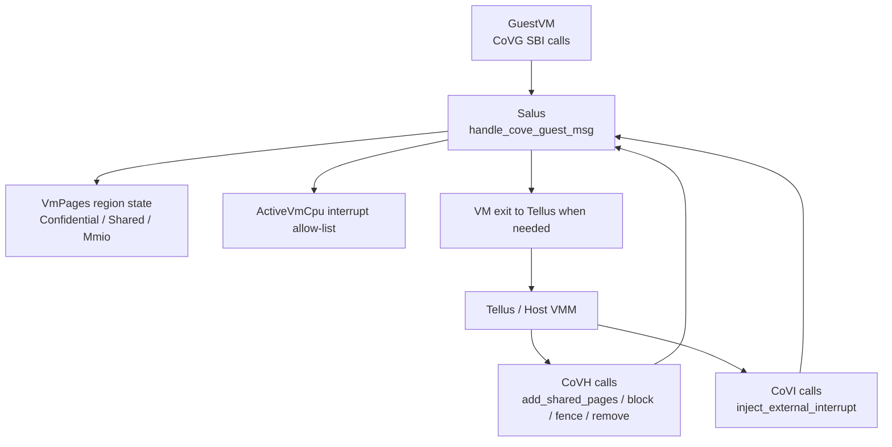
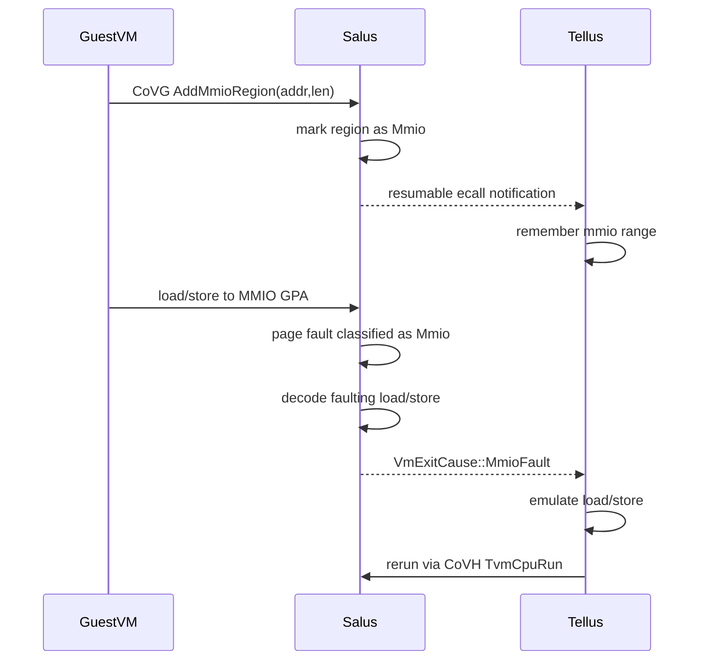
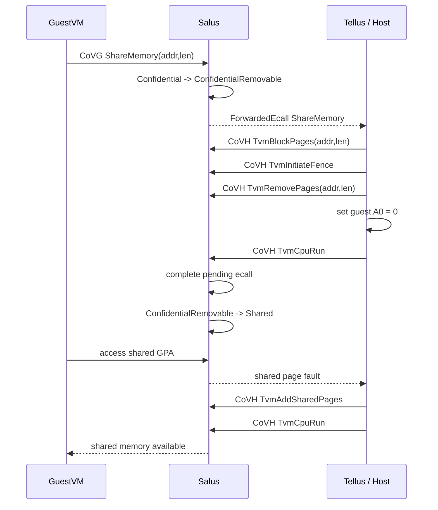
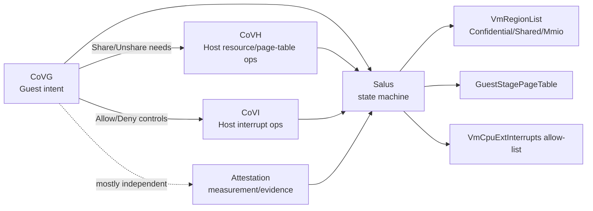

# CoVG 接口功能与实现说明

本文总结 Salus 项目中 CoVG，也就是 COVE Guest 接口，在 Rust 代码里的实现方法、实现细节，以及它与其他 CoVE 接口之间的依赖关系。

当前工作树中的 `sbi-rs` 子模块没有展开，因此本文以 Salus 实际实现入口 `src/vm.rs::handle_cove_guest_msg()` 中匹配到的接口为准。

## 总览

CoVG 是 GuestVM 侧 ABI。调用方是运行在 Salus 管理下的 confidential guest，而不是 Host/Tellus。

当前 Salus 实现的 CoVG 接口包括：

- `AddMmioRegion`
- `RemoveMmioRegion`
- `ShareMemory`
- `UnshareMemory`
- `AllowExternalInterrupt`
- `DenyExternalInterrupt`

入口函数：

```rust
fn handle_cove_guest_msg(
    &self,
    guest_func: CoveGuestFunction,
    active_vcpu: &ActiveVmCpu<T>,
) -> EcallAction
```

第一条规则很重要：

```rust
if active_vcpu.is_host_vcpu() {
    return Err(EcallError::Sbi(SbiError::NotSupported)).into();
}
```

也就是说，CoVG 不支持 Host VM 调用，只支持 GuestVM 调用。Tellus/Host 应使用 CoVH。

## CoVG 在系统中的位置



CoVG 的设计不是让 GuestVM 直接改页表或直接访问 Host 资源，而是让 GuestVM 表达意图：

- “这段内存我要共享给 Host。”
- “这段共享内存我要收回为 confidential。”
- “这段 GPA 是我希望 Host 模拟的 MMIO。”
- “这个外部中断 ID 我允许 Host 注入。”

Salus 先更新 GuestVM 内部状态，然后在需要 Host 参与时把事件转成 VM exit 给 Tellus。Tellus 再通过 CoVH/CoVI 完成 parent 侧操作。

## 相关内部结构

### `VmPages<T>`

CoVG 的内存相关接口最终都落到 `src/vm_pages.rs` 的 `VmPages`：

```rust
pub struct VmPages<T: GuestStagePagingMode> {
    page_owner_id: PageOwnerId,
    page_tracker: PageTracker,
    tlb_tracker: TlbTracker,
    regions: RwLock<VmRegionList>,
    nesting: usize,
    root: GuestStagePageTable<T>,
    pte_pages: PtePagePool,
    imsic_geometry: Once<GuestImsicGeometry>,
    iommu_context: Once<VmIommuContext>,
}
```

CoVG 主要修改 `regions`，即 GuestVM GPA 空间的逻辑区域类型。

### GuestVM region 类型

与 CoVG 关系最密切的是这些 region：

- `Confidential`
  - GuestVM 私有内存。
- `Shared`
  - GuestVM 与 Host 共享的内存。
- `ConfidentialRemovable`
  - share 流程中的临时状态，表示这段 confidential region 正准备移除旧映射并转为 shared。
- `SharedRemovable`
  - unshare 流程中的临时状态，表示这段 shared region 正准备移除旧映射并转回 confidential。
- `Mmio`
  - GuestVM 声明的 emulated MMIO region。访问此区域会 exit 给 Host/Tellus 模拟。

### `ActiveVmCpu`

中断相关接口落到 `ActiveVmCpu`：

- `allow_ext_interrupt(id)`
- `allow_all_ext_interrupts()`
- `deny_ext_interrupt(id)`
- `deny_all_ext_interrupts()`

这些函数维护当前 vCPU 的外部中断 allow-list。Host/Tellus 后续通过 CoVI 注入外部中断时，Salus 会依据这个 allow-list 决定是否允许。

## 接口一：`AddMmioRegion`

### 功能

GuestVM 声明一段 GPA 为 emulated MMIO region。后续 GuestVM 对这段地址的 load/store 不映射真实内存，而是 VM exit 给 Host/Tellus，由 Host 模拟。

GuestVM 测试代码中：

```rust
cove_guest::add_emulated_mmio_region(GUEST_MMIO_START_ADDRESS, PAGE_SIZE_4K)
```

### Salus 实现

分发：

```rust
AddMmioRegion { addr, len } => self.add_mmio_region(addr, len)
```

实现：

```rust
fn add_mmio_region(&self, addr: u64, len: u64) -> EcallResult<u64> {
    let addr = self.guest_addr_from_raw(addr)?;
    self.vm_pages()
        .add_mmio_region(addr, len)
        .map_err(EcallError::from)?;
    Ok(0)
}
```

后端：

```rust
FinalizedVmPages::add_mmio_region()
do_add_region(..., VmRegionType::Mmio)
```

### 行为细节

- 只修改 GuestVM 的 region table。
- 不立即映射物理页。
- 成功后 Salus 返回成功给 GuestVM，同时通过 VM exit 通知 Host/Tellus。
- Host/Tellus 记录这个 region，后续 page fault 时进行 MMIO 模拟。

Tellus 侧典型处理：

```rust
AddMmioRegion { addr, len } => {
    mmio_region = Some(addr..addr + len);
}
```

### 伪代码

```text
function CoVG_AddMmioRegion(vm, addr, len):
    if caller_is_host:
        return NotSupported

    gpa = vm.guest_addr_from_raw(addr)
    vm.vm_pages.regions.add(gpa, gpa + len, Mmio)

    notify_host_resumable_ecall(AddMmioRegion(addr, len))
    return 0
```

## 接口二：`RemoveMmioRegion`

### 功能

GuestVM 删除之前声明的 emulated MMIO region。

GuestVM 测试代码：

```rust
cove_guest::remove_emulated_mmio_region(GUEST_MMIO_START_ADDRESS, PAGE_SIZE_4K)
```

### Salus 实现

分发：

```rust
RemoveMmioRegion { addr, len } => self.remove_mmio_region(addr, len)
```

实现：

```rust
fn remove_mmio_region(&self, addr: u64, len: u64) -> EcallResult<u64> {
    let addr = self.guest_addr_from_raw(addr)?;
    self.vm_pages()
        .remove_mmio_region(addr, len)
        .map_err(EcallError::from)?;
    Ok(0)
}
```

后端：

```rust
FinalizedVmPages::remove_mmio_region()
do_remove_region(..., VmRegionType::Mmio)
```

Tellus 侧会检查删除的 range 是否与记录一致，然后清空 `mmio_region`。

### 伪代码

```text
function CoVG_RemoveMmioRegion(vm, addr, len):
    gpa = vm.guest_addr_from_raw(addr)
    vm.vm_pages.regions.remove(gpa, gpa + len, Mmio)

    notify_host_resumable_ecall(RemoveMmioRegion(addr, len))
    return 0
```

## MMIO fault 后续路径

`AddMmioRegion` 只是声明 region，真正的 MMIO 访问发生在后续 load/store page fault。

Salus `run_vcpu()` 中：

1. GuestVM 对 MMIO GPA load/store。
2. 触发 Guest page fault。
3. Salus 调：

```rust
active_pages.get_page_fault_cause(exception, fault_addr)
```

4. 如果类型是 `PageFaultType::Mmio`：
   - fetch faulting instruction。
   - 解码成 `MmioOperation`。
   - 返回 `VmExitCause::MmioFault(mmio_op, fault_addr)` 给 Host/Tellus。

Tellus 根据 `CSR_HTINST` 或 shared memory 中的上下文模拟 load/store：

- load：写 guest GPR。
- store：读取 guest GPR 并打印。



## 接口三：`ShareMemory`

### 功能

GuestVM 请求把一段 confidential memory 转成 shared memory，使 Host/Tellus 可以共享访问。

GuestVM 测试代码：

```rust
cove_guest::share_memory(
    GUEST_SHARED_PAGES_START_ADDRESS,
    NUM_GUEST_SHARED_PAGES * PAGE_SIZE_4K,
)
```

### Salus 实现

分发：

```rust
ShareMemory { addr, len } | UnshareMemory { addr, len } => {
    let result = if matches!(guest_func, ShareMemory { .. }) {
        self.share_mem_region(addr, len)
    } else {
        self.unshare_mem_region(addr, len)
    };

    let action = match result {
        Ok(_) => EcallAction::Forward(SbiMessage::CoveGuest(guest_func)),
        Err(_) => result.map(|_| 0).into(),
    };
    return action;
}
```

具体实现：

```rust
fn share_mem_region(&self, addr: u64, len: u64) -> EcallResult<()> {
    let addr = self.guest_addr_from_raw(addr)?;
    self.vm_pages()
        .share_mem_region(addr, len)
        .map_err(EcallError::from)
}
```

后端：

```rust
FinalizedVmPages::share_mem_region()
do_convert_mem_region(page_addr, len, share = true)
```

`do_convert_mem_region` 将 region 从：

```text
Confidential -> ConfidentialRemovable
```

### 为什么要 Forward 给 Host

`ShareMemory` 不能由 GuestVM 单方面完成。原因：

- 如果这段 GPA 已有 confidential page 映射，必须由 Host/Tellus 通过 CoVH 执行 block/fence/remove。
- Host/Tellus 决定是否接受共享请求。
- Host/Tellus 后续负责在 page fault 时用 `TvmAddSharedPages` 补 shared page。

因此 Salus 在 region 状态更新成功后返回：

```rust
EcallAction::Forward(SbiMessage::CoveGuest(guest_func))
```

这会让 `TvmCpuRun` 退出到 Tellus。Tellus 读取到 GuestVM 的 `ShareMemory` 请求后：

1. 记录 shared GPA range。
2. 如果该 range 已经有旧映射，执行：

```rust
cove_host::block_pages(vmid, addr, len)
cove_host::tvm_initiate_fence(vmid)
cove_host::remove_pages(vmid, addr, len)
```

3. 将 guest A0 设置为 0，表示 Host 接受。
4. 下次 GuestVM 访问该 shared range 时触发 fault。
5. Tellus 调：

```rust
cove_host::add_shared_pages(...)
```

### pending ecall completion

Salus 在下一次运行 GuestVM 前会调用：

```rust
active_vcpu.try_complete_pending_op(|sbi_msg, sbi_ret| {
    self.complete_pending_ecall(sbi_msg, sbi_ret)
})?;
```

如果 Host/Tellus 给 guest A0 返回 0，Salus 完成 share：

```rust
complete_share_mem_region(addr, len)
```

这个函数要求相关页表 range 已经为空，然后将 region 从：

```text
ConfidentialRemovable -> Shared
```

如果 Host/Tellus 返回非 0，Salus reject：

```text
ConfidentialRemovable -> Confidential
```

### ShareMemory 伪代码

```text
function CoVG_ShareMemory(vm, addr, len):
    gpa = vm.guest_addr_from_raw(addr)

    # Salus 先把 region 转成“准备移除”的中间状态
    vm.regions.update(
        gpa..gpa+len,
        from = Confidential,
        to = ConfidentialRemovable
    )

    # 交给 Host/Tellus 决定是否接受，并执行 block/fence/remove
    forward_to_host(ShareMemory(addr, len))
```

Host 接受后的 completion：

```text
function CompletePendingShare(vm, addr, len, host_ret):
    if host_ret == 0:
        require guest.gstage.range_is_empty(addr, len)
        vm.regions.update(
            addr..addr+len,
            from = ConfidentialRemovable,
            to = Shared
        )
    else:
        vm.regions.update(
            addr..addr+len,
            from = ConfidentialRemovable,
            to = Confidential
        )
```

## 接口四：`UnshareMemory`

### 功能

GuestVM 请求把 shared memory 收回成 confidential memory。

GuestVM 测试代码：

```rust
cove_guest::unshare_memory(
    GUEST_SHARED_PAGES_START_ADDRESS,
    NUM_GUEST_SHARED_PAGES * PAGE_SIZE_4K,
)
```

### Salus 实现

具体实现：

```rust
fn unshare_mem_region(&self, addr: u64, len: u64) -> EcallResult<()> {
    let addr = self.guest_addr_from_raw(addr)?;
    self.vm_pages()
        .unshare_mem_region(addr, len)
        .map_err(EcallError::from)
}
```

后端：

```rust
FinalizedVmPages::unshare_mem_region()
do_convert_mem_region(page_addr, len, share = false)
```

region 状态变化：

```text
Shared -> SharedRemovable
```

然后 Salus 同样 forward 给 Host/Tellus。

Tellus 如果接受，会对已有 shared mapping 执行：

```rust
cove_host::block_pages(vmid, addr, len)
cove_host::tvm_initiate_fence(vmid)
cove_host::remove_pages(vmid, addr, len)
```

然后设置 guest A0 为 0。

下一次进入 GuestVM 前，Salus completion：

```text
SharedRemovable -> Confidential
```

后续 GuestVM 再访问该地址，会触发 confidential page fault。Tellus 再通过 CoVH：

```rust
cove_host::add_zero_pages(...)
```

补新的 confidential page。

### UnshareMemory 伪代码

```text
function CoVG_UnshareMemory(vm, addr, len):
    gpa = vm.guest_addr_from_raw(addr)

    vm.regions.update(
        gpa..gpa+len,
        from = Shared,
        to = SharedRemovable
    )

    forward_to_host(UnshareMemory(addr, len))
```

completion：

```text
function CompletePendingUnshare(vm, addr, len, host_ret):
    if host_ret == 0:
        require guest.gstage.range_is_empty(addr, len)
        vm.regions.update(
            addr..addr+len,
            from = SharedRemovable,
            to = Confidential
        )
    else:
        vm.regions.update(
            addr..addr+len,
            from = SharedRemovable,
            to = Shared
        )
```

## Share / Unshare 完整时序



Unshare 类似，只是 region 状态为：

```text
Shared -> SharedRemovable -> Confidential
```

然后下一次访问由 Host/Tellus 用 `TvmAddZeroPages` 补 confidential page。

## 接口五：`AllowExternalInterrupt`

### 功能

GuestVM 允许 Host/Tellus 向当前 vCPU 注入某个外部中断 ID。

GuestVM 测试代码：

```rust
cove_guest::allow_external_interrupt(3)
```

### Salus 实现

分发：

```rust
AllowExternalInterrupt { id } => self.allow_ext_interrupt(id, active_vcpu)
```

实现：

```rust
fn allow_ext_interrupt(&self, id: i64, active_vcpu: &ActiveVmCpu<T>) -> EcallResult<u64> {
    if id == -1 {
        active_vcpu.allow_all_ext_interrupts()
    } else {
        active_vcpu.allow_ext_interrupt(id as usize)
    }
    .map_err(|_| EcallError::Sbi(SbiError::InvalidParam))?;
    Ok(0)
}
```

语义：

- `id == -1` 表示允许所有外部中断。
- 否则只允许指定 interrupt ID。
- 成功后 Salus 会 break 到 Host/Tellus，通知这个 CoVG 调用成功。

Tellus 收到 `AllowExternalInterrupt` 后，测试代码会通过 CoVI：

```rust
cove_interrupt::inject_external_interrupt(vmid, 0, id)
```

向 GuestVM 注入中断。

### 伪代码

```text
function CoVG_AllowExternalInterrupt(active_vcpu, id):
    if id == -1:
        active_vcpu.interrupt_allow_list.allow_all()
    else:
        active_vcpu.interrupt_allow_list.allow(id)

    notify_host_resumable_ecall(AllowExternalInterrupt(id))
    return 0
```

## 接口六：`DenyExternalInterrupt`

### 功能

GuestVM 撤销对某个外部中断 ID 的允许。

### Salus 实现

分发：

```rust
DenyExternalInterrupt { id } => self.deny_ext_interrupt(id, active_vcpu)
```

实现：

```rust
fn deny_ext_interrupt(&self, id: i64, active_vcpu: &ActiveVmCpu<T>) -> EcallResult<u64> {
    if id == -1 {
        active_vcpu.deny_all_ext_interrupts()
    } else {
        active_vcpu.deny_ext_interrupt(id as usize)
    }
    .map_err(|_| EcallError::Sbi(SbiError::InvalidParam))?;
    Ok(0)
}
```

语义：

- `id == -1` 表示拒绝所有外部中断。
- 否则拒绝指定 interrupt ID。

### 伪代码

```text
function CoVG_DenyExternalInterrupt(active_vcpu, id):
    if id == -1:
        active_vcpu.interrupt_allow_list.deny_all()
    else:
        active_vcpu.interrupt_allow_list.deny(id)

    notify_host_resumable_ecall(DenyExternalInterrupt(id))
    return 0
```

## CoVG 调用成功后的 Host 通知机制

除 `ShareMemory` / `UnshareMemory` 外，其他 CoVG 调用走统一逻辑：

```rust
match result {
    Ok(r) => EcallAction::Break(
        VmExitCause::ResumableEcall(SbiMessage::CoveGuest(guest_func)),
        SbiReturn::success(r as i64),
    ),
    Err(_) => result.into(),
}
```

这表示：

1. Salus 已经完成本地状态更新。
2. GuestVM 的 SBI 返回值设置为 success。
3. vCPU run 退出给 Host/Tellus。
4. Host/Tellus 可以观察到这次 CoVG 调用，并更新自己的 shadow 状态或执行后续动作。

`ShareMemory` / `UnshareMemory` 特殊：它们不是本地立即完成，而是 `Forward` 给 Host，等待 Host 返回值后由 `complete_pending_ecall()` 完成或回滚 region 状态。

## CoVG 与其他 CoVE 接口的关系

结论：**CoVG 不是完全独立的接口族。它有独立的 Guest ABI 入口，但实际功能经常依赖 CoVH 和 CoVI 配合完成。**

### 与 CoVH 的依赖

CoVG share/unshare 强依赖 CoVH。

GuestVM 只能请求：

```text
ShareMemory / UnshareMemory
```

但真正修改 GuestVM 页表旧映射、执行 TLB fence、移除页面、补 shared/zero pages，需要 Tellus 调 CoVH：

- `TvmBlockPages`
- `TvmInitiateFence`
- `TvmRemovePages`
- `TvmAddSharedPages`
- `TvmAddZeroPages`

换句话说：

- CoVG 表达 guest 意图。
- CoVH 执行 parent/VMM 侧的资源管理。
- Salus 负责在两者之间维护安全状态机。

### 与 CoVI 的依赖

CoVG interrupt allow/deny 与 CoVI 相关。

GuestVM 通过 CoVG：

```text
AllowExternalInterrupt(id)
```

只是更新 allow-list。Host/Tellus 真正注入中断，需要 CoVI：

```text
TvmCpuInjectExternalInterrupt(tvm_id, vcpu_id, interrupt_id)
```

Salus 在注入路径中会依据 vCPU allow-list 决定是否允许。

因此：

- CoVG 控制 guest 授权。
- CoVI 执行 host 注入。

### 与 attestation 接口的关系

当前 CoVG 与 attestation 基本独立。

- Attestation 使用 `EXT_ATTESTATION`，由 `handle_attestation_msg()` 处理。
- CoVG 不直接读写 measurement registers，也不生成 evidence。
- 但内存共享/页表状态会影响 GuestVM 运行时行为，间接影响 guest 后续可能扩展的 runtime measurement。

### 与 NACL/shared memory 的关系

CoVG VM exit 通知依赖 Host/Tellus 能读到 GuestVM 的 ecall 信息。Tellus 测试中通过 NACL shared memory area 读取 guest A 寄存器和 CSR 状态。

但这属于运行/退出报告机制，不是 CoVG 本身的接口。

## 依赖关系图



## CoVG 接口速查表

| 接口 | GuestVM 意图 | Salus 本地动作 | 是否通知/依赖 Host |
|---|---|---|---|
| `AddMmioRegion` | 声明 emulated MMIO range | 添加 `Mmio` region | 通知 Host 记录 MMIO range |
| `RemoveMmioRegion` | 删除 emulated MMIO range | 移除 `Mmio` region | 通知 Host 删除 shadow range |
| `ShareMemory` | confidential -> shared | `Confidential -> ConfidentialRemovable` | 强依赖 Host 通过 CoVH block/fence/remove/补 shared pages |
| `UnshareMemory` | shared -> confidential | `Shared -> SharedRemovable` | 强依赖 Host 通过 CoVH block/fence/remove/补 zero pages |
| `AllowExternalInterrupt` | 允许中断注入 | 更新 vCPU allow-list | Host 通过 CoVI 注入 |
| `DenyExternalInterrupt` | 拒绝中断注入 | 更新 vCPU allow-list | Host 后续 CoVI 注入会受限 |

## 易懂版总结

CoVG 可以理解成 GuestVM 对 Salus 说的话：

- “这段地址是 MMIO，之后请让 Host 模拟。”
- “这段私有内存我愿意共享给 Host。”
- “这段共享内存我要收回为私有。”
- “这个外部中断我允许/不允许 Host 注入。”

但 GuestVM 不能直接改二阶段页表，也不能直接拿 Host 的物理页。Salus 会先把 GuestVM 的意图记录为安全的中间状态，然后让 Tellus/Host 通过 CoVH 或 CoVI 完成 parent 侧资源操作。

因此 CoVG 的实现是“独立入口 + 依赖协作”：

- 入口独立：CoVG 有自己的 SBI function 和 Salus handler。
- 状态不独立：它修改的是 `VmPages`、`VmRegionList`、`ActiveVmCpu` 等 VM 公共状态。
- 完成不独立：share/unshare 依赖 CoVH，interrupt 注入依赖 CoVI，MMIO 模拟依赖 Host/Tellus 的 VM exit 处理。
