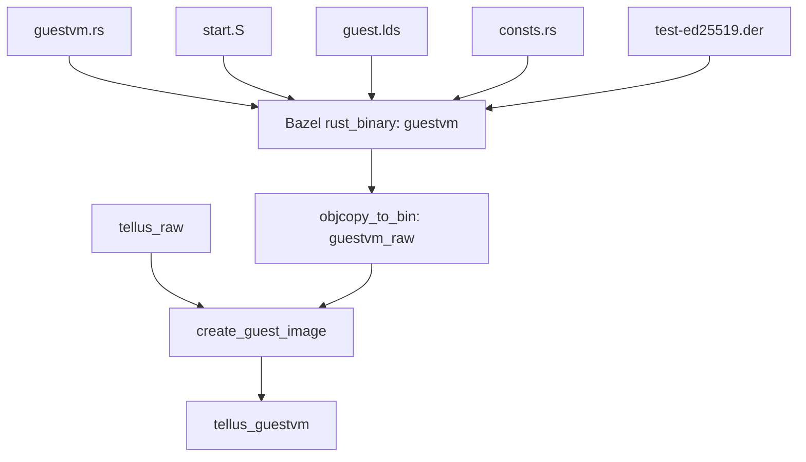
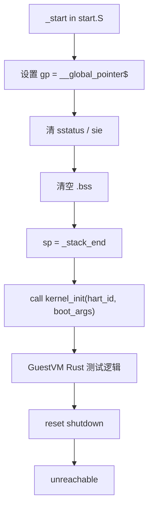
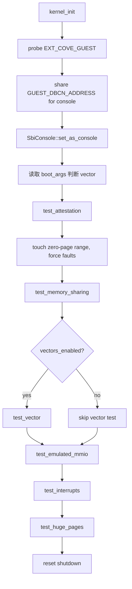

# GuestVM 执行流程与镜像内存分布

本文总结 Salus 项目中 `guestvm` 测试镜像的构建来源、启动执行流程，以及它在合成镜像和 GuestVM 自身 GPA 空间中的内存分布。

## 相关文件

GuestVM 镜像相关代码主要位于 `test-workloads/`：

- `test-workloads/src/bin/guestvm.rs`
  - GuestVM 主体 Rust 代码。
  - 包含 `kernel_init()`，以及 attestation、memory sharing、emulated MMIO、interrupt、huge page 等测试。
- `test-workloads/src/start.S`
  - GuestVM 和 Tellus 共用的裸机启动汇编。
  - 定义 `_start` 和 `_secondary_start`。
- `test-workloads/guest.lds`
  - GuestVM 链接脚本。
  - 定义入口、section 布局、BSS、stack。
- `test-workloads/src/consts.rs`
  - GuestVM/Tellus 共享的地址布局常量。
- `test-workloads/BUILD`
  - Bazel 构建目标，定义 `guestvm`、`guestvm_raw`、`tellus_guestvm`。
- `test-workloads/create_guest_image/main.rs`
  - 将 `tellus_raw` 和 `guestvm_raw` 拼成最终 `tellus_guestvm` 合成镜像。
- `test-workloads/src/bin/test-ed25519.der`
  - GuestVM attestation 测试使用的 CSR/DER 数据。

## 镜像构建链路

`test-workloads/BUILD` 中，GuestVM 的构建目标是：

```python
rust_binary(
    name = "guestvm",
    srcs = [
        "src/bin/guestvm.rs",
        "src/consts.rs",
    ],
    crate_root = "src/bin/guestvm.rs",
    data = glob([
        "src/**/*.S",
        "src/**/*.der",
    ]),
    linker_script = "guest.lds",
    rustc_flags = [
        "--codegen=link-arg=-nostartfiles",
    ],
)
```

然后：

```python
objcopy_to_bin(
    name = "guestvm_raw",
    src = ":guestvm",
)
```

最后与 Tellus 镜像合成：

```python
genrule(
    name = "tellus_guestvm_rule",
    srcs = [
        ":tellus_raw",
        ":guestvm_raw",
    ],
    outs = ["tellus_guestvm"],
    cmd = "$(location :create_guest_image) $(SRCS) $@ " + str(max_tellus_size),
)
```

构建关系：



## 合成镜像中的位置

`create_guest_image/main.rs` 的逻辑是：

1. 先把 `tellus_raw` 写入输出文件。
2. 检查 Tellus 长度不能超过固定 offset。
3. seek 到 offset。
4. 再写入 `guestvm_raw`。

offset 来自：

```text
NUM_TELLUS_IMAGE_PAGES * PAGE_SIZE_4K
= 512 * 4096
= 0x20_0000
= 2 MiB
```

合成镜像 `tellus_guestvm` 的布局：

```text
0x8020_0000
+------------------------------+
| Tellus image                  |
| size <= 512 pages = 2 MiB     |
+------------------------------+ 0x8040_0000
| GuestVM raw image             |
+------------------------------+
```

注意这里的 `0x8040_0000` 是从 Tellus 视角看合成镜像中 GuestVM 原始镜像的位置。

Tellus 在 `test-workloads/src/bin/tellus.rs` 中用下面的地址找到 GuestVM image：

```rust
let guest_image_base = USABLE_RAM_START_ADDRESS + PAGE_SIZE_4K * NUM_TELLUS_IMAGE_PAGES;
```

即：

```text
guest_image_base = 0x8020_0000 + 0x20_0000 = 0x8040_0000
```

Tellus 读取这段 raw image，并通过 CoVH `TvmAddMeasuredPages` 把它映射到 GuestVM 自己的 GPA `0x8020_0000`。

## GuestVM 链接脚本布局

`test-workloads/guest.lds` 定义：

```ld
ENTRY( _start )

MEMORY
{
    ram (wxa) : ORIGIN = 0x80200000, LENGTH = 128M
}
```

所以 GuestVM 自己被链接为从：

```text
0x8020_0000
```

开始执行。

section 顺序：

```text
0x8020_0000
+------------------+
| .start           |  _start 所在 section
+------------------+
| .text            |
+------------------+
| .rodata          |
+------------------+
| .data            |  4 KiB aligned
| .sdata           |  __global_pointer$
+------------------+
| .bss             |  _bss_start .. _bss_end
+------------------+
| stack            |  _stack_start = _bss_end
|                  |  size = 0x30000
+------------------+  _stack_end
```

链接脚本还丢弃：

```ld
*(.eh_frame)
```

## GuestVM 启动执行流程

入口在 `test-workloads/src/start.S`：

```asm
.global _start
_start:
    la gp, __global_pointer$
    csrw sstatus, zero
    csrw sie, zero

    # Clear BSS
    la   a3, _bss_start
    la   a4, _bss_end
    ...

    la   sp, _stack_end
    call kernel_init
    j    wfi_loop
```

启动流程：



`_secondary_start` 也在 `start.S` 中定义，但 GuestVM 目前的 `secondary_init` 是空实现：

```rust
#[no_mangle]
extern "C" fn secondary_init(_hart_id: u64) {}
```

## `kernel_init()` 执行流程

GuestVM 的主入口在 `test-workloads/src/bin/guestvm.rs`：

```rust
extern "C" fn kernel_init(hart_id: u64, boot_args: u64)
```

执行步骤：

1. 检查 Salus 是否支持 CoVG：

   ```rust
   base::probe_sbi_extension(sbi_rs::EXT_COVE_GUEST)
   ```

2. 将 debug console buffer 所在页共享给 Host/Tellus：

   ```rust
   cove_guest::share_memory(GUEST_DBCN_ADDRESS, PAGE_SIZE_4K)
   ```

3. 将 `GUEST_DBCN_ADDRESS` 映射为 `SbiConsole` 使用的 buffer。

4. 打印启动信息，并声明 `guestvm boot` 测试通过。

5. 根据 `boot_args` 判断 vector extension 是否启用：

   ```rust
   let vectors_enabled = boot_args & BOOT_ARG_VECTORS_ENABLED != 0;
   ```

6. 执行 attestation 测试：

   ```rust
   test_attestation()
   ```

7. 访问 zero page 区域，强制触发 page fault，让 Tellus 用 CoVH 补页：

   ```rust
   while next_page < end {
       write/read 0xdeadbeef
   }
   ```

8. 执行 memory sharing 测试：

   ```rust
   test_memory_sharing()
   ```

9. 如果 vector 开启，执行 vector 测试：

   ```rust
   test_vector()
   ```

10. 执行 emulated MMIO 测试：

    ```rust
    test_emulated_mmio()
    ```

11. 执行 interrupt 测试：

    ```rust
    test_interrupts()
    ```

12. 执行 huge page promote/demote 测试：

    ```rust
    test_huge_pages()
    ```

13. 调 SBI reset shutdown 退出：

    ```rust
    reset::reset(Shutdown, NoReason)
    ```

流程图：



## GuestVM 自己看到的 GPA 分布

`test-workloads/src/consts.rs` 描述了 GuestVM 的 GPA 空间。核心常量如下：

| 区域 | 起始地址 | 大小/结束 | 用途 |
|---|---:|---:|---|
| Emulated MMIO | `0x1000_8000` | `4 KiB` | `test_emulated_mmio()` 中声明为 MMIO region |
| IMSIC | `0x2800_0000` | `1 MiB` | Guest interrupt file 区域 |
| Guest image / data pages | `0x8020_0000` | `160 * 4 KiB` | GuestVM 初始 measured pages |
| Guest zero pages | `0x8020_0000 + 160 * 4 KiB` | `50 * 4 KiB` | 运行期 fault-in 的 confidential zero pages |
| Shared pages | `0x1_0000_0000` | `1 * 4 KiB` | `test_memory_sharing()` 使用 |
| Shared console buffer | `GUEST_DBCN_ADDRESS` | `4 KiB` | debug console shared buffer |
| Huge page promote test | `0x1_1000_0000` | `512 * 4 KiB = 2 MiB` | 先补 4K 页，再 promote 成 2M |
| Huge page demote test | `0x1_1000_0000 + 512 * 4 KiB` | `512 * 4 KiB = 2 MiB` | 先补 2M 页，再 demote 成 4K |
| Guest RAM end | `0x1_8000_0000` | - | GuestVM GPA 空间上界 |

展开后的示意图：

```text
GuestVM GPA view

0x1000_0000
+-----------------------------+
| gap                         |
+-----------------------------+ 0x1000_8000
| MMIO, 4 KiB                 |
+-----------------------------+
| gap                         |
+-----------------------------+ 0x2800_0000
| IMSIC, 1 MiB                |
+-----------------------------+
| gap                         |
+-----------------------------+ 0x8020_0000
| Guest image / measured data |
| 160 pages = 640 KiB         |
+-----------------------------+
| Guest zero pages            |
| 50 pages = 200 KiB          |
+-----------------------------+
| gap                         |
+-----------------------------+ 0x1_0000_0000
| Shared pages                |
| 1 page = 4 KiB              |
+-----------------------------+
| Shared console buffer       |
| 1 page = 4 KiB              |
+-----------------------------+
| gap                         |
+-----------------------------+ 0x1_1000_0000
| Huge page promote area      |
| 512 pages = 2 MiB           |
+-----------------------------+
| Huge page demote area       |
| 512 pages = 2 MiB           |
+-----------------------------+
| gap                         |
+-----------------------------+ 0x1_8000_0000
```

## GuestVM image 与 measured pages

Tellus 创建 GuestVM 时，会把合成镜像里的 GuestVM raw image 当作源数据：

```rust
let guest_image_base =
    USABLE_RAM_START_ADDRESS + PAGE_SIZE_4K * NUM_TELLUS_IMAGE_PAGES;
```

然后调用：

```rust
cove_host::add_measured_pages(
    vmid,
    guest_image,
    next_page,
    TsmPageType::Page4k,
    USABLE_RAM_START_ADDRESS,
)
```

含义：

- `guest_image`：Tellus 地址空间中的 GuestVM raw image，位置是 `0x8040_0000`。
- `next_page`：Tellus 捐赠给 GuestVM 的 converted backing pages。
- `USABLE_RAM_START_ADDRESS`：GuestVM 看到的目标 GPA，即 `0x8020_0000`。

Salus 在映射 measured pages 时会扩展 attestation PCR2：

```rust
measurement.extend_tvm_page(page.as_bytes(), to_addr.bits())
```

所以 GuestVM 初始镜像内容和映射 GPA 都进入 measurement。

## 各测试与内存区域的关系

### Attestation

`test_attestation()`：

- 使用 `test-ed25519.der` 作为 CSR。
- 调 `EXT_ATTESTATION` 查询能力。
- 扩展并读取 runtime PCR。
- 获取 evidence certificate。
- 解析 DICE TcbInfo extension。

主要依赖：

- Guest image measured pages。
- Salus attestation manager。
- U-mode evidence 生成。

### Zero page fault-in

`kernel_init()` 中主动访问：

```text
GUEST_ZERO_PAGES_START_ADDRESS
  .. GUEST_ZERO_PAGES_END_ADDRESS
```

这些页面一开始不完全映射。GuestVM 写入时触发 page fault，Tellus 捕获后调用：

```rust
cove_host::add_zero_pages(...)
```

补 confidential zero pages。

### Memory sharing

`test_memory_sharing()` 使用：

```text
GUEST_SHARED_PAGES_START_ADDRESS = 0x1_0000_0000
```

流程：

1. GuestVM 调 `cove_guest::share_memory`。
2. Tellus 接受，并后续用 `TvmAddSharedPages` 补 shared page。
3. GuestVM 读到 `GUEST_SHARE_PING` 后写 `GUEST_SHARE_PONG`。
4. GuestVM 调 `unshare_memory`，转回 confidential。
5. GuestVM 再 share 一次。

### Debug console shared buffer

启动早期 GuestVM 共享：

```text
GUEST_DBCN_ADDRESS
= GUEST_SHARED_PAGES_START_ADDRESS + 1 * 4 KiB
```

这页作为 `SbiConsole` 的 shared buffer，让 Host/Tellus 能处理 debug console 输出。

### Emulated MMIO

`test_emulated_mmio()` 使用：

```text
GUEST_MMIO_START_ADDRESS = 0x1000_8000
```

流程：

1. GuestVM 调 `add_emulated_mmio_region`。
2. 对该地址执行 volatile write/read。
3. Salus 将 page fault 分类为 MMIO。
4. Tellus 模拟 load/store。
5. GuestVM 调 `remove_emulated_mmio_region`。

### Interrupt

`test_interrupts()`：

- 执行 `wfi`。
- 设置 IMSIC 相关 CSR。
- 调 `cove_guest::allow_external_interrupt(3)`。
- Tellus 收到后通过 CoVI 注入外部中断。
- GuestVM 用 `stopi` 检查是否有 supervisor external interrupt pending。

### Huge pages

`test_huge_pages()` 使用：

```text
GUEST_PROMOTE_HUGE_PAGE_START_ADDRESS = 0x1_1000_0000
GUEST_DEMOTE_HUGE_PAGE_START_ADDRESS  = 0x1_1020_0000
```

promote 测试：

1. GuestVM 写 `0x1_1000_0000`。
2. Tellus 补 512 个 4K zero pages。
3. Tellus block/fence/promote 成 2M page。
4. GuestVM 验证首尾地址都可访问。

demote 测试：

1. GuestVM 写 demote 区域起始地址。
2. Tellus 补 1 个 2M zero page。
3. Tellus block/fence/demote 成 512 个 4K pages。
4. GuestVM 验证首尾地址都可访问。

## 总结

GuestVM 镜像本身是一个裸机 RISC-V `no_std` Rust binary：

- 入口 `_start` 来自 `start.S`。
- 链接地址从 `0x8020_0000` 开始。
- Rust 主入口是 `kernel_init()`。
- 它通过 CoVG、attestation、reset 等 SBI 接口与 Salus 交互。

需要区分两个地址视角：

```text
合成镜像视角:
    Tellus 位于 0x8020_0000
    GuestVM raw image 位于 0x8040_0000

GuestVM 自身 GPA 视角:
    GuestVM image 被映射到 0x8020_0000
```

Tellus 负责从合成镜像中取出 GuestVM raw image，并通过 CoVH `TvmAddMeasuredPages` 把它装载到 GuestVM 的 GPA `0x8020_0000`。GuestVM 启动后依次测试 attestation、按需补页、内存共享、vector、MMIO、中断和 huge page 页表变换，最后通过 SBI reset shutdown 退出。
