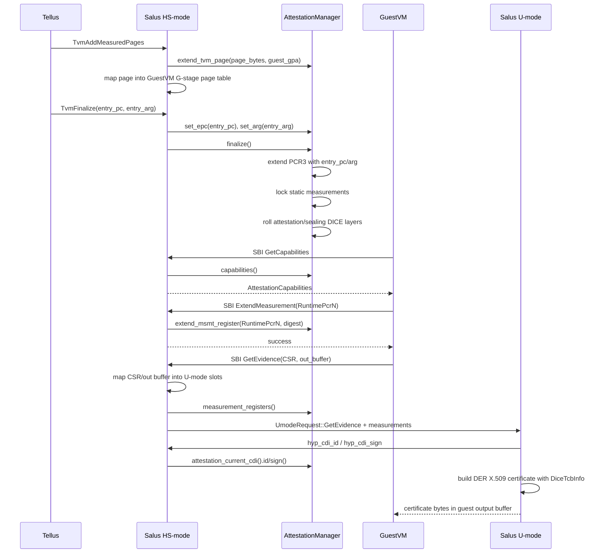

# Salus 远程证明、测量与报告实现分析

本文基于当前 Rust 代码，分析 Salus 项目中 attestation、measurement、evidence/reporting 的实现方式，并用伪代码描述关键路径。

## 总览

Salus 的远程证明实现由三层代码共同完成：

```text
GuestVM
  |
  | SBI EXT_ATTESTATION
  v
Salus HS-mode
  |
  | AttestationManager + U-mode request
  v
Salus U-mode helper
  |
  | DER X.509 certificate with DICE TcbInfo extension
  v
GuestVM
```

核心分工：

- `attestation/`
  - 维护测量寄存器。
  - 维护 DICE CDI layer。
  - 计算 attestation TCI / sealing TCI。
  - 提供 capabilities、extend、read、finalize、measurement export。
- `src/vm.rs`
  - 每个 `Vm<T>` 拥有一个 `AttestationManager<sha2::Sha384>`。
  - 处理 GuestVM 发起的 attestation SBI 调用。
- `src/vm_pages.rs`
  - 映射 measured pages 时自动扩展 TVM page measurement。
- `src/umode.rs`
  - 把 GuestVM 的 CSR 和输出证书缓冲区映射进 Salus U-mode。
  - 把测量寄存器数据传给 U-mode helper。
  - 向 U-mode 暴露 CDI ID / CDI sign hypercall。
- `u-mode/`
  - 解析 GuestVM 提供的 CSR。
  - 构造 DICE TcbInfo extension。
  - 用 CDI 对证书签名。
  - 输出 DER X.509 certificate。
- `test-workloads/src/bin/guestvm.rs`
  - 测试 capabilities、runtime PCR extend/read、get evidence、解析证书。

## 关键数据结构

### `AttestationManager`

定义在 `attestation/src/manager.rs`：

```rust
pub struct AttestationManager<D: Digest, H: HmacImpl<D> = hmac::Hmac<D>> {
    measurements: RwLock<ArrayVec<MeasurementRegister<D>, MSMT_REGISTERS>>,
    attestation_layer: LayerBase<CDI_LEN, Signature, LocalCdi<CDI_LEN, D, H>>,
    sealing_layer: LayerBase<CDI_LEN, Signature, LocalCdi<CDI_LEN, D, H>>,
    vm_id: u64,
    tvm_config: RwLock<TvmConfiguration>,
    _pd: PhantomData<H>,
}
```

它是每个 VM 的 attestation 状态中心，保存：

- PCR 风格测量寄存器。
- Attestation CDI layer。
- Sealing CDI layer。
- VM ID。
- TVM 初始配置：entry PC 和 entry ARG。

Salus 中的 `Vm<T>` 包含：

```rust
attestation_mgr: AttestationSha384
```

其中：

```rust
type AttestationSha384 = AttestationManager<sha2::Sha384>;
```

### `MeasurementRegister`

定义在 `attestation/src/measurement.rs`：

```rust
pub struct MeasurementRegister<D: Digest> {
    pub tcb_layer: Option<u8>,
    pub fwid_index: u8,
    pub pcr_index: u8,
    pub extensible: bool,
    pub static_measurement: bool,
    pub stable: bool,
    pub hash_algorithm: ObjectIdentifier,
    pub digest: MeasurementRegisterDigest<D>,
}
```

每个寄存器有三类重要属性：

- `static_measurement`
  - static register 在 `finalize()` 后会锁定，不能再 extend。
- `stable`
  - sealing TCI 只使用 stable measurement。
- `extensible`
  - 控制当前寄存器是否还能被 extend。

extend 算法：

```rust
new_digest = Hash(old_digest || optional_address_le || bytes)
```

代码对应：

```rust
let mut hasher = D::new_with_prefix(self.digest.clone());
if let Some(address) = address {
    hasher.update(address.to_le_bytes());
}
hasher.update(bytes);
self.digest = hasher.finalize();
```

## 测量寄存器布局

`attestation/src/lib.rs` 定义：

```rust
STATIC_MSMT_REGISTERS = 4
DYNAMIC_MSMT_REGISTERS = 4
MSMT_REGISTERS = 8
```

`TcgPcrIndex` 映射：

| PCR | 名称 | 用途 |
|---:|---|---|
| 0 | `PlatformCode` | 平台可信固件代码，当前注释说来自 RoT |
| 1 | `PlatformConfiguration` | 平台配置，非 stable |
| 2 | `TvmPage` | TVM 页面内容测量 |
| 3 | `TvmConfiguration` | TVM entry PC / argument |
| 17 | `RuntimePcr0` | 动态 runtime PCR |
| 18 | `RuntimePcr1` | 动态 runtime PCR |
| 19 | `RuntimePcr2` | 动态 runtime PCR |
| 20 | `RuntimePcr3` | 动态 runtime PCR |

`attestation/src/measurement.rs` 中的 `TVM_MSMT_REGISTERS` 将它们映射到 DICE TcbInfo 的 FWID index：

```rust
fwid 0 -> PCR0  PlatformCode
fwid 1 -> PCR1  PlatformConfiguration
fwid 2 -> PCR2  TvmPage
fwid 3 -> PCR3  TvmConfiguration
fwid 4 -> PCR17 RuntimePcr0
fwid 5 -> PCR18 RuntimePcr1
fwid 6 -> PCR19 RuntimePcr2
fwid 7 -> PCR20 RuntimePcr3
```

## AttestationManager 创建

在 `src/vm.rs` 中，创建 VM 时会创建 attestation manager：

```rust
AttestationSha384::new(
    b"RANDOMATTESTATIONCDI",
    b"RANDOMSEALINGCDI",
    vm_id,
    const_oid::db::rfc5912::ID_SHA_384,
)
```

当前实现里 CDI 是占位常量：

```rust
// Fake compound device identifiers (DICE CDI)
// TODO Get the CDI from e.g. the TSM driver.
```

这说明当前代码实现了完整的软件链路，但 RoT/TSM 提供真实 CDI 的部分仍是 TODO。

伪代码：

```text
function create_vm_attestation_manager(vm_id):
    att_cdi = extract_or_use_32_bytes("RANDOMATTESTATIONCDI")
    seal_cdi = extract_or_use_32_bytes("RANDOMSEALINGCDI")

    measurements = []
    for builder in TVM_MSMT_REGISTERS:
        measurements.push(builder.build(SHA384_OID))

    return AttestationManager {
        measurements,
        attestation_layer = LayerBase(LocalCdi(att_cdi, Attestation)),
        sealing_layer = LayerBase(LocalCdi(seal_cdi, Attestation)),
        vm_id,
        tvm_config = { entry_pc: 0, entry_arg: 0 },
    }
```

## 静态页面测量

GuestVM 初始镜像通过 Tellus 调用 `TvmAddMeasuredPages` 加入。Salus 在映射 measured pages 时测量页面内容。

关键代码在 `src/vm_pages.rs`：

```rust
impl MeasuredPagesMapper {
    pub fn map_page(..., measurement: &AttestationManager<D, H>) {
        measurement.extend_tvm_page(page.as_bytes(), to_addr.bits())?;
        self.do_map_page(to_addr, page)
    }
}
```

`extend_tvm_page` 固定扩展 PCR2：

```rust
pub fn extend_tvm_page(&self, bytes: &[u8], address: u64) -> Result<()> {
    self.extend_msmt_register(TcgPcrIndex::TvmPage, bytes, Some(address))
}
```

因此 TVM page measurement 包含：

- GuestVM page 的 GPA。
- GuestVM page 的实际字节内容。

伪代码：

```text
function map_measured_page(vm, guest_gpa, physical_page):
    bytes = physical_page.as_bytes()

    # PCR2 = H(PCR2 || guest_gpa_le || page_bytes)
    vm.attestation_mgr.extend(TvmPage, bytes, address=guest_gpa)

    # 建立 GuestVM G-stage 映射
    vm.gstage.map(guest_gpa, physical_page)
```

这保证同样内容映射到不同 Guest GPA 会得到不同测量值。

## TVM 配置测量

`Vm::finalize()` 中：

```rust
self.attestation_mgr.set_epc(entry_sepc);
self.attestation_mgr.set_arg(entry_arg);
self.attestation_mgr.finalize()
```

`AttestationManager::finalize()` 会先扩展 TVM configuration：

```rust
self.extend_tvm_configuration()?;
```

配置测量内容：

```rust
PCR3 = H(PCR3 || entry_pc_le)
PCR3 = H(PCR3 || entry_arg_le)
```

然后：

```rust
for m in self.measurements.write().iter_mut() {
    m.finalize()
}
```

`MeasurementRegister::finalize()` 会锁定 static measurements：

```rust
self.static_measurement.then(|| self.extensible = false);
```

伪代码：

```text
function finalize_vm(vm, entry_pc, entry_arg):
    vm.attestation_mgr.tvm_config.entry_pc = entry_pc
    vm.attestation_mgr.tvm_config.entry_arg = entry_arg

    extend(PCR3, entry_pc_le)
    extend(PCR3, entry_arg_le)

    for reg in measurements:
        if reg.static_measurement:
            reg.extensible = false

    roll_attestation_dice_layer()
    roll_sealing_dice_layer()
```

## DICE TCI 与 CDI 派生

`AttestationManager` 派生两个 TCI：

```rust
fn attestation_tci(&self) {
    Hash(all static measurement digests)
}

fn sealing_tci(&self) {
    Hash(all stable measurement digests)
}
```

区别：

- Attestation TCI 包含所有 static measurements。
- Sealing TCI 只包含 stable measurements。

finalize 时 roll DICE layer：

```rust
self.attestation_layer.roll(
    Some(&self.vm_id.to_le_bytes()),
    Some(&self.attestation_tci()),
)?;

self.sealing_layer.roll(
    Some(&self.vm_id.to_le_bytes()),
    Some(&self.sealing_tci()),
)?;
```

伪代码：

```text
function roll_attestation_layers(vm):
    attestation_tci = Hash(
        digest(reg) for reg in measurements
        if reg.static_measurement
    )

    sealing_tci = Hash(
        digest(reg) for reg in measurements
        if reg.stable
    )

    attestation_layer = DICE.roll(vm_id_le, attestation_tci)
    sealing_layer = DICE.roll(vm_id_le, sealing_tci)
```

当前证据签名使用 `attestation_current_cdi()`，即 finalize 后 roll 出来的 attestation layer current CDI。

## Runtime measurement

GuestVM 可通过 attestation SBI 扩展动态 PCR。测试代码在 `test-workloads/src/bin/guestvm.rs`：

```rust
attestation::extend_measurement(&digest, RuntimePcr1 as usize)
```

Salus 侧处理在 `src/vm.rs`：

```rust
fn guest_extend_measurement(msmt_addr, msmt_size, index, active_pages)
```

策略：

1. 将 index 转为 `TcgPcrIndex`。
2. 查询 capabilities，确认输入大小等于 hash size。
3. 从 GuestVM GPA 拷贝 measurement data。
4. 调用 `AttestationManager::extend_msmt_register(...)`。

伪代码：

```text
function guest_extend_measurement(vm, gpa, size, index):
    pcr = TcgPcrIndex.try_from(index)
    caps = vm.attestation_mgr.capabilities()

    if size != caps.hash_algorithm.size:
        return SBI_ERR_INSUFFICIENT_BUFFER

    data = copy_from_guest(vm, gpa, size)

    # Runtime PCR:
    # PCR = H(PCR || data)
    vm.attestation_mgr.extend(pcr, data, address=None)

    return 0
```

GuestVM 测试中验证了 extend 语义：

```text
RuntimePCR1 = SHA384(ZeroDigest || SHA384("helloworld"))
```

## Measurement read

GuestVM 可读取测量寄存器：

```rust
attestation::read_measurement(RuntimePcr1 as usize)
```

Salus 侧：

```rust
fn guest_read_measurement(msmt_addr, msmt_size, index, active_pages)
```

策略：

1. 校验 index。
2. 读取 `AttestationManager::read_msmt_register`.
3. 检查 guest 输出 buffer 大小。
4. 拷贝 digest 到 GuestVM。

伪代码：

```text
function guest_read_measurement(vm, out_gpa, out_size, index):
    pcr = TcgPcrIndex.try_from(index)
    digest = vm.attestation_mgr.read(pcr)

    if out_size < len(digest):
        return SBI_ERR_INSUFFICIENT_BUFFER

    copy_to_guest(vm, out_gpa, digest)
    return len(digest)
```

## Capabilities 报告

GuestVM 调：

```rust
attestation::get_capabilities()
```

Salus 侧：

```rust
fn get_attestation_capabilities(caps_addr_out, caps_size, active_pages)
```

`AttestationManager::capabilities()` 返回：

- `tcb_svn`
  - 当前是 `0xdeadbeef`，代码中 TODO 表示未来应来自 RoT。
- `HashAlgorithm::Sha384`
- `EvidenceFormat::DiceTcbInfo`
- static register 数量。
- dynamic register 数量。
- 每个 measurement register descriptor。

伪代码：

```text
function get_capabilities(vm, out_gpa, out_size):
    if out_size < sizeof(AttestationCapabilities):
        return SBI_ERR_INSUFFICIENT_BUFFER

    caps = {
        tcb_svn = 0xdeadbeef,
        hash_algorithm = SHA384,
        evidence_format = DiceTcbInfo,
        static_count = 4,
        dynamic_count = 4,
        descriptors = measurements.map(to_sbi_descriptor),
    }

    copy_to_guest(vm, out_gpa, bytes(caps))
    return 0
```

## Evidence / Report 生成路径

GuestVM 调：

```rust
attestation::get_evidence(TEST_CSR, request_data, EvidenceFormat::DiceTcbInfo)
```

Salus 侧在 `src/vm.rs`：

```rust
fn guest_get_evidence(
    csr_guest_addr,
    csr_len,
    request_data_addr,
    evidence_format,
    certout_guest_addr,
    certout_len,
)
```

当前实现细节：

- `_request_data_addr` 未使用。
- `_evidence_format` 未使用。
- 实际固定走 U-mode 的 `get_certificate_sha384`，输出 DiceTcbInfo 证书。

然后调用：

```rust
UmodeTask::attestation_evidence(...)
```

### HS-mode 到 U-mode 的映射

`src/umode.rs` 中：

```rust
pub fn attestation_evidence(...)
```

关键步骤：

1. 将 GuestVM CSR buffer 映射到 U-mode Slot A，只读。
2. 将 GuestVM certificate output buffer 映射到 U-mode Slot B，可写。
3. 从 `AttestationManager` 提取所有 measurement registers。
4. 将 measurements 打包成 `u_mode_api::cert::MeasurementRegisters`。
5. 写入 U-mode Input Region。
6. 设置 `UmodeRequest::GetEvidence`。
7. 运行 U-mode task。

伪代码：

```text
function salus_get_evidence(vm, csr_gpa, csr_len, cert_gpa, cert_len):
    csr_uva = map_guest_range_to_umode(
        vm_pages = vm.vm_pages,
        guest_gpa = csr_gpa,
        len = csr_len,
        slot = A,
        perms = readonly,
    )

    cert_uva = map_guest_range_to_umode(
        vm_pages = vm.vm_pages,
        guest_gpa = cert_gpa,
        len = cert_len,
        slot = B,
        perms = writable,
    )

    regs = vm.attestation_mgr.measurement_registers()
    input = MeasurementRegisters { regs }
    copy_to_umode_input(input)

    request = GetEvidence {
        csr_addr = csr_uva,
        csr_len = csr_len,
        certout_addr = cert_uva,
        certout_len = cert_len,
    }

    return run_umode(request, attestation_mgr = vm.attestation_mgr)
```

### U-mode 证书生成

U-mode 主循环在 `u-mode/src/main.rs`：

```rust
UmodeRequest::GetEvidence { ... } => self.op_get_evidence(...)
```

`op_get_evidence`：

1. 把 `csr_addr/csr_len` 转成只读 slice。
2. 把 `certout_addr/certout_len` 转成可写 slice。
3. 从 U-mode Input Region 读取 `MeasurementRegisters`。
4. 调 `cert::get_certificate_sha384(...)`。

`u-mode/src/cert.rs` 中 `get_certificate_sha384`：

1. 复制并解析 CSR。
2. 验证 CSR 签名。
3. 构造 `DiceTcbInfo`。
4. 把 8 个 measurement register digest 作为 FWID 加入 TcbInfo。
5. 将 TcbInfo 编码为 X.509 extension。
6. 创建 `Layer<..., UmodeCdi, sha2::Sha384>`。
7. 用 CDI 对 CSR 生成证书。
8. 拷贝 DER certificate 到 guest 输出 buffer。

伪代码：

```text
function umode_get_certificate_sha384(csr_input, measurements, cert_output):
    if len(csr_input) > MAX_CSR_LEN:
        return INVALID_ARGUMENT

    csr = parse_der_cert_request(csr_input)
    csr.verify()

    tcb_info = DiceTcbInfo.new()
    for digest in measurements.msmt_regs:
        tcb_info.add_fwid(hash_algorithm = SHA384_OID, digest)

    tcb_extension = tcb_info.to_x509_extension()

    layer = Layer(
        current_cdi = UmodeCdi(AttestationCurrent),
        next_cdi = UmodeCdi(AttestationNext),
    )

    cert_der = layer.csr_certificate(csr, extensions = [tcb_extension])

    if len(cert_output) < len(cert_der):
        return INVALID_ARGUMENT

    cert_output.write(cert_der)
    return len(cert_der)
```

## U-mode CDI 调用

U-mode 自己不持有 CDI 私钥。它通过 hypercall 请求 HS-mode Salus 执行 CDI 操作。

`u-mode/src/cert.rs` 中：

```rust
struct UmodeCdi {
    cdi: CdiSel,
}

impl CompoundDeviceIdentifier for UmodeCdi {
    fn id(&self) {
        hyp_cdi_id(self.cdi, &mut id)
    }
}

impl Signer<Signature> for UmodeCdi {
    fn try_sign(&self, msg) {
        hyp_cdi_sign(self.cdi, msg, &mut signature)
    }
}
```

HS-mode 处理在 `src/umode.rs`：

```rust
fn handle_cdi_op(attestation, cdi_sel, cdi_op)
```

当前只支持：

```rust
CdiSel::AttestationCurrent
```

对于 `Id`：

```text
id = attmgr.attestation_current_cdi().id()
copy_to_umode(idout_addr, id)
```

对于 `Sign`：

```text
msg = copy_from_umode(msg_addr, msg_len)
signature = attmgr.attestation_current_cdi().sign(msg)
copy_to_umode(signout_addr, signature)
```

这形成了一个重要隔离边界：

- U-mode 负责复杂 ASN.1 / X.509 / DER 逻辑。
- HS-mode 保留 CDI 私钥操作。
- U-mode 只能通过受控 hypercall 请求签名。

## GuestVM 测试验证

`test-workloads/src/bin/guestvm.rs` 中 `test_attestation()` 测试：

1. probe `EXT_ATTESTATION`。
2. `get_capabilities()`。
3. 检查支持 `EvidenceFormat::DiceTcbInfo`。
4. extend `RuntimePcr1`。
5. read `RuntimePcr1` 并比对预期 digest。
6. 发送测试 CSR。
7. 调 `get_evidence(...)`。
8. 解析返回的 DER certificate。
9. 查找 DICE TCB Info extension。
10. 从 FWID list 中取 `TvmPage` 对应 digest 并打印。

伪代码：

```text
function guest_test_attestation():
    assert probe(EXT_ATTESTATION)

    caps = get_capabilities()
    assert DiceTcbInfo in caps.evidence_formats

    digest = SHA384("helloworld")
    extend_measurement(digest, RuntimePcr1)

    actual = read_measurement(RuntimePcr1)
    expected = SHA384(zero_sha384_digest || digest)
    assert actual == expected

    cert = get_evidence(test_csr, request_data, DiceTcbInfo)
    parsed = X509.parse(cert)
    tcb_info = parsed.extension(TCG_DICE_TCB_INFO)
    tvm_page_fwid = tcb_info.fwids[TvmPage]

    print(tvm_page_fwid.digest)
```

## 完整远程证明时序



## 当前实现限制与注意点

1. **CDI 当前是 fake 值**

   VM 创建时使用：

   ```rust
   b"RANDOMATTESTATIONCDI"
   b"RANDOMSEALINGCDI"
   ```

   代码中明确 TODO：未来应从 TSM driver 或 RoT 获取真实 CDI。

2. **TCB SVN 当前是占位值**

   `attestation/src/manager.rs`：

   ```rust
   const TCB_SVN: u64 = 0xdeadbeef;
   ```

   注释说明未来应来自 RoT。

3. **GetEvidence 的 request_data 和 evidence_format 当前未使用**

   `src/vm.rs` 中参数名为：

   ```rust
   _request_data_addr
   _evidence_format
   ```

   当前实际固定生成 SHA-384 + DICE TcbInfo 格式证书。

4. **U-mode 只支持 AttestationCurrent CDI**

   `handle_cdi_op` 对 `CdiSel::AttestationNext`、sealing CDI 等会返回 unexpected。

5. **U-mode 不持有秘密**

   U-mode 负责证书构造，但签名通过 HS-mode CDI hypercall 完成。这是合理的隔离策略。

6. **证据格式是证书，不是裸 report**

   `GetEvidence` 返回的是 DER 编码 X.509 certificate。DICE TCB Info 作为证书 extension 携带 measurement FWIDs。

7. **当前工作树中 `sbi-rs` 子模块未展开**

   本文对 SBI 结构体细节的描述基于调用点、类型名和使用方式；底层 `sbi_rs` 定义文件在当前 checkout 中不可见。

## 核心总结

Salus 的 attestation 实现可以概括为：

```text
测量：
    measured pages -> PCR2
    entry pc/arg   -> PCR3
    runtime guest  -> PCR17..20

派生：
    static measurements -> attestation TCI -> attestation CDI layer
    stable measurements -> sealing TCI     -> sealing CDI layer

报告：
    Guest CSR + measurement registers
        -> U-mode builds DICE TcbInfo X.509 certificate
        -> HS-mode CDI signs certificate
        -> Guest receives DER certificate
```

这种设计把敏感状态和页面测量保留在 HS-mode Salus 中，把复杂且容易出错的证书/ASN.1 构造放到 U-mode helper 中执行。GuestVM 看到的是标准化的 attestation SBI 接口：查询能力、扩展/读取测量、获取 evidence certificate。
