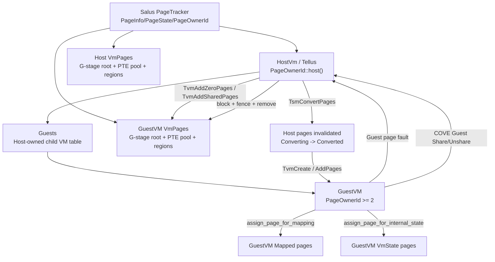

# Salus / Tellus / GuestVM 页面与页表管理关系

本文总结当前 Rust 代码中 Salus、Tellus、GuestVM 三者之间的页面所有权、页表管理和运行期页面流转策略。

## 三者角色

```text
QEMU / firmware
    |
    v
Salus              HS-mode hypervisor
    |
    v
Tellus             Salus 启动的 Host VM，测试用 VMM
    |
    v
GuestVM            Tellus 通过 Salus COVE Host API 创建的 confidential guest
```

- **Salus** 是真正管理物理页、G-stage 页表和 VM exit 的 hypervisor。
- **Tellus** 在 Salus 看来是 Host VM；在测试逻辑里，它又像一个 VMM，负责创建、装载、运行和销毁 GuestVM。
- **GuestVM** 是 Tellus 通过 `TvmCreate` / `TvmAdd*` / `TvmCpuRun` 等 COVE Host SBI 调用创建出来的子 VM。

代码上，Salus 的 Host VM 不是一个完全独立的类型体系，而是一个特殊包装：

- `src/host_vm.rs`
  - `HostVm<T> { inner: GuestVm<T> }`
- `src/guest_tracking.rs`
  - `GuestVm<T>`
  - `Guests<T>`
  - `GuestState::{Init, Running}`
- `src/vm.rs`
  - `Vm<T>`
  - `VmRef<'a, T, S>`
  - `VmStateInitializing`
  - `VmStateFinalized`

也就是说，Host/Tellus 在 Salus 内部也是一个 `GuestVm<T>`，只是它的 `Vm<T>` 通过 `Vm::with_guest_tracking(...)` 带有 `Guests<T>`，因此它可以拥有和管理子 GuestVM。

## 镜像与地址布局

`test-workloads/BUILD` 先构建两个裸机程序：

- `tellus`
- `guestvm`

然后通过 `create_guest_image` 合成：

```text
tellus_guestvm
```

`scripts/run_tellus.sh` 中 QEMU 直接加载：

```bash
-kernel salus
-device guest-loader,kernel=tellus_guestvm,addr=${KERNEL_ADDR}
```

`test-workloads/src/consts.rs` 定义了合成镜像布局：

```text
0x8020_0000
+------------------+
| Tellus image     |
+------------------+  + NUM_TELLUS_IMAGE_PAGES
| GuestVM image    |
+------------------+
```

Tellus 启动后用：

```rust
let guest_image_base = USABLE_RAM_START_ADDRESS + PAGE_SIZE_4K * NUM_TELLUS_IMAGE_PAGES;
```

找到 GuestVM image，并把它作为 measured pages 加入 GuestVM 的 GPA 空间。

## 全局物理页所有权

全局物理页状态由 `page-tracking` 管理，核心结构是：

- `PageTracker`
- `PageTrackerInner`
- `PageMap`
- `PageInfo`
- `PageState`
- `PageOwnerId`

`riscv-pages/src/page_owner_id.rs` 中定义：

```rust
0 = host
1 = hypervisor
2.. = guest id
```

即：

- `PageOwnerId::host()` 表示 Tellus / Host VM。
- `PageOwnerId::hypervisor()` 表示 Salus 自己。
- `PageOwnerId::new(id)` 表示 Tellus 创建出来的 GuestVM。

`PageInfo` 为每个 4 KiB 物理页保存：

- `mem_type: MemType`
- `state: PageState`
- `owners: ArrayVec<PageOwnerId, MAX_PAGE_OWNERS>`
- `link`

`owners` 是页面的 chain-of-custody。当前代码里：

```rust
pub const MAX_PAGE_OWNERS: usize = 2;
```

这意味着当前支持的嵌套深度基本是 Host -> GuestVM，一层 guest 嵌套。Salus 在 `VmPages::do_convert_pages()` 中也检查：

```rust
if self.inner.nesting >= MAX_PAGE_OWNERS - 1 {
    return Err(Error::NestingTooDeep);
}
```

## PageState 策略

`page-tracking/src/page_info.rs` 中的 `PageState` 是整个内存隔离策略的核心。

重要状态如下：

- `Reserved`
  - 不可用或固件/设备保留。
- `Free`
  - 启动早期的空闲页；正常启动完成后不应再存在普通 free 页面。
- `Mapped`
  - 页面已映射到当前 owner 的地址空间。
- `Shared(u64)`
  - 页面仍属于当前 owner，但被共享给子 VM；带引用计数。
- `VmState`
  - 页面用作某个 VM 的 Salus 内部状态，例如 VM 结构体、vCPU 状态、G-stage 页表页。
- `HypState`
  - Salus 自己内部使用，不能重新分配。
- `Converting(TlbVersion)`
  - owner 已经从自己的页表中 invalidate，等待 fence 完成，之后可变成 `Converted`。
- `Converted`
  - 页面已经完成转换，可以被 assign 给子 VM 或 reclaim。
- `ConvertedLocked`
  - `Converted` 页面被独占锁住，正在 assign/reclaim。
- `Blocked(TlbVersion)`
  - 页面被 Host invalidate，用于 remove/promote/demote/share/unshare 等需要 TLB 协调的操作。
- `BlockedShared(u64, TlbVersion)`
  - shared page 的 blocked 版本。

典型状态流：

```text
Mapped
  |
  | TsmConvertPages / invalidate_range
  v
Converting(tlb_version)
  |
  | fence 完成后 get_converted_page
  v
Converted
  |
  | lock_for_assignment
  v
ConvertedLocked
  |
  | assign_page_for_mapping / assign_page_for_internal_state
  v
Mapped 或 VmState
```

共享相关状态流：

```text
Mapped
  |
  | share_page
  v
Shared(refcount)
  |
  | release
  v
Mapped
```

页表结构变更相关状态流：

```text
Mapped / Shared
  |
  | block_pages + invalidate_range
  v
Blocked / BlockedShared
  |
  | tvm_initiate_fence
  v
remove_pages / promote_page / demote_page / unblock_pages
```

## 每个 VM 的 GPA 与 G-stage 页表

每个 VM 的页表和 GPA 区域由 `src/vm_pages.rs` 中的 `VmPages<T>` 管理：

```rust
pub struct VmPages<T: GuestStagePagingMode> {
    page_owner_id: PageOwnerId,
    page_tracker: PageTracker,
    tlb_tracker: TlbTracker,
    regions: RwLock<VmRegionList>,
    nesting: usize,
    root: GuestStagePageTable<T>,
    pte_pages: PtePagePool,
    imsic_geometry: Once<GuestImsicGeometry>,
    iommu_context: Once<VmIommuContext>,
}
```

它负责：

- 保存 VM 的 `PageOwnerId`。
- 持有全局 `PageTracker`。
- 维护该 VM 的 `TlbTracker`。
- 维护 VM GPA 空间的区域类型 `VmRegionList`。
- 持有该 VM 的 G-stage root page table。
- 管理额外的 PTE page pool。
- 管理 IMSIC / IOMMU 上下文。

页表本身由 `riscv-page-tables` 实现：

- `GuestStagePagingMode`
- `GuestStagePageTable<T>`
- `GuestStageMapper<'a, T>`

`GuestStagePageTable` 是 VM 的二阶段页表；运行 VM 时写入 `hgatp`，用于 GPA -> SPA 翻译。

## VM GPA 区域类型

`VmPages` 不只是映射页，还维护 GPA 区域类型。主要策略是：只有地址落在正确 region 中，相关映射/转换操作才允许执行。

重要 region 类型包括：

- `Confidential`
  - Guest 独占私有内存。
  - 可通过 `map_zero_pages` / `map_measured_pages` 映射。
- `Shared`
  - Guest 与 parent/Tellus 共享的内存。
  - 可通过 `map_shared_pages` 映射。
- `Mmio`
  - 不直接映射真实 RAM；访问会 exit 给 parent 处理。
- `Imsic`
  - 虚拟中断文件映射区域。
- `Pci`
  - PCI BAR 等设备区域。
- `ConfidentialRemovable` / `SharedRemovable`
  - share/unshare 过程中使用的临时状态，要求 Host 先 block/fence/remove 旧映射，再 complete。

Guest 侧调用 `ShareMemory` / `UnshareMemory` 时，Salus 不会立即神奇地完成所有映射变化，而是先改变 region 状态，退出给 Tellus，让 Tellus 负责协调 block、fence、remove 和重新 fault-in。

## Salus 启动 Tellus 时的页面策略

Salus 启动时在 `src/main.rs` 中：

1. 从 FDT 构造 `HwMemMap`。
2. 为 Salus 自己保留 hypervisor image、FDT、heap、内部状态页。
3. 用 `HypPageAlloc` 组织剩余可用物理页。
4. 创建 `PageTracker`。
5. 创建 Host/Tellus 的 `HostVm<Sv48x4>`。

`HostVm::from_hyp_mem(...)` 中的关键动作：

- 分配 Host G-stage root page table pages。
- 分配 Host 预留 PTE pages。
- 分配 Host 的 `GuestVm` 状态页。
- 分配 Host 的 guest tracking pages。
- 为每个 Host vCPU 分配 vCPU state pages。
- 创建全局 `PageTracker`，剩余页面作为 Host 可用页面返回。
- 创建 Host 的 `GuestStagePageTable`：

```rust
GuestStagePageTable::new(root_table_pages, PageOwnerId::host(), page_tracker)
```

- 创建 Host 的 `VmPages::new(root, 0)`，其中 `nesting = 0`。
- 创建 Host 的 VM：

```rust
Vm::with_guest_tracking(vm_pages, VmCpus::new(), Guests::new(...))
```

这就是 Host/Tellus 与普通 GuestVM 的关键区别：Host VM 的 `Vm` 带有 `Guests<T>`，所以它能通过 COVE Host API 创建子 VM。

## Tellus 创建 GuestVM 的页面流程

Tellus 的主流程在 `test-workloads/src/bin/tellus.rs`。

### 1. 查询 Salus TSM 信息

Tellus probe：

```rust
base::probe_sbi_extension(EXT_COVE_HOST)
```

然后：

```rust
let tsm_info = cove_host::get_info()
```

Salus 侧 `TsmGetInfo` 返回创建 TVM 所需的状态页数量，例如：

- `tvm_state_pages`
- `tvm_vcpu_state_pages`

### 2. Tellus 转换 TVM 创建所需页面

Tellus 调：

```rust
convert_pages(next_page, tvm_create_pages)
```

对应 Salus 侧：

- `VmPages::convert_pages`
- `VmPages::do_convert_pages`
- `GuestStagePageTable::invalidate_range`
- `PageTracker::convert_page`

语义是：Tellus 把自己 GPA 中的一段页面从 Host/Tellus 页表中 invalidate，进入 `Converting(TlbVersion)` / `Converted` 流程，准备交给 GuestVM 用。

### 3. Tellus 调 TvmCreate

Tellus：

```rust
let vmid = cove_host::tvm_create(tvm_page_directory_addr, tvm_state_addr)
```

Salus 侧在 `src/vm.rs`：

```rust
fn add_guest(...)
```

关键步骤：

1. 从 Tellus 地址空间复制 `TvmCreateParams`。
2. 从 Tellus 的 `VmPages` 中取出已 converted 的 page-directory pages：

```rust
self.vm_pages().get_converted_pages(page_root_addr, PageSize::Size4k, 4)
```

3. 取出 GuestVM 状态页：

```rust
self.vm_pages().get_converted_pages(state_page_addr, PageSize::Size4k, GuestVm::<T>::required_pages())
```

4. 分配新的 `PageOwnerId`：

```rust
self.page_tracker().add_active_guest()
```

5. 把这些 converted pages assign 给新 GuestVM：

```rust
assign_pages(..., id)
```

内部调用：

```rust
PageTracker::assign_page_for_internal_state
```

6. 创建新 GuestVM 的 G-stage root：

```rust
GuestStagePageTable::new(guest_root_pages, id, self.page_tracker())
```

7. 创建新 GuestVM 的 `VmPages`：

```rust
VmPages::new(guest_root, self.vm_pages().nesting() + 1)
```

8. 创建 `Vm::new(...)` 和 `GuestVm::new(...)`，并加入 Host/Tellus 的 `Guests<T>` 表。

### 4. Tellus 添加 GuestVM 页表页

Tellus 继续转换一批页面：

```rust
convert_pages(next_page, NUM_COVE_PTE_PAGES)
```

然后：

```rust
cove_host::add_page_table_pages(vmid, next_page, NUM_COVE_PTE_PAGES)
```

Salus 会把这些 converted pages 作为 GuestVM 的 `PtePagePool`，用于后续建立 G-stage 映射。

### 5. Tellus 添加 GuestVM vCPU

Tellus 转换 vCPU state pages：

```rust
convert_pages(vcpu_pages_base, tsm_info.tvm_vcpu_state_pages)
```

然后：

```rust
cove_host::add_vcpu(vmid, 0, vcpu_pages_base)
```

Salus 把这些页面作为 `VmCpu` 内部状态页，归属新 GuestVM。

### 6. Tellus 声明 GuestVM GPA confidential region

Tellus：

```rust
cove_host::add_memory_region(
    vmid,
    USABLE_RAM_START_ADDRESS,
    GUEST_RAM_END_ADDRESS - USABLE_RAM_START_ADDRESS,
)
```

Salus 对应 `InitializingVmPages::add_confidential_memory_region`，将这段 Guest GPA 标为 `Confidential`。

注意：声明 region 不等于映射页面。它只是规定未来哪些 GPA 可以被映射为 confidential memory。

### 7. Tellus 添加 measured pages

Tellus 找到 GuestVM image 后：

```rust
cove_host::add_measured_pages(
    vmid,
    guest_image,
    next_page,
    TsmPageType::Page4k,
    USABLE_RAM_START_ADDRESS,
)
```

策略：

- source 是 Tellus 内存中的 GuestVM image。
- dest 是 Tellus 先前 converted 出来的物理页。
- Salus 把这些页面 assign 给 GuestVM。
- 映射到 GuestVM GPA `USABLE_RAM_START_ADDRESS`。
- 同时加入 attestation measurement。

这类页面通常是 GuestVM 初始代码和数据。

### 8. Tellus finalize GuestVM

Tellus：

```rust
cove_host::tvm_finalize(vmid, 0x8020_0000, boot_arg)
```

Salus：

- `GuestVm::finalize`
- `Vm::finalize`
- 设置 boot vCPU entry。
- finalizes attestation manager。
- VM 状态从 `Init` 变为 `Running`。

finalize 后，某些初始化期操作不再允许；运行期主要通过 fault-in、share/unshare、block/remove 等流程管理页面。

## GuestVM 运行期缺页策略

Tellus 用循环运行 GuestVM：

```rust
loop {
    let fatal = cove_host::tvm_run(vmid, 0)? != 0;
    ...
}
```

Salus 侧 `TvmCpuRun` 最终进入 GuestVM。GuestVM 发生 fault/ECALL/interrupt 后，Salus 退出回 Tellus，并通过 shared memory / CSR 报告原因。

### Confidential zero page fault

GuestVM 访问尚未映射的 confidential GPA 时：

1. Salus 发现 Guest load/store page fault。
2. `VmExitCause::PageFault(...)` 返回给 Tellus。
3. Tellus 判断 fault address。
4. Tellus 调：

```rust
cove_host::add_zero_pages(vmid, page_addr, page_type, num_pages, guest_addr)
```

Salus：

- 从 Tellus converted page 池中取页面。
- assign 给 GuestVM。
- 通过 `VmPages::map_zero_pages` 建立 GuestVM G-stage 映射。

因此 GuestVM 的很多 RAM 是 demand paging，由 Tellus 在 fault 后补页。

### Shared page fault

GuestVM 先通过 COVE Guest API 请求：

```rust
cove_guest::share_memory(addr, len)
```

Salus 处理 guest ECALL 时：

- 将该 GPA region 标为 `ConfidentialRemovable`。
- 退出给 Tellus，Tellus 接受后设置返回值。
- Tellus 在后续 fault 中调用：

```rust
cove_host::add_shared_pages(...)
```

Salus：

- 从 Tellus/Host 的 mapped/shareable page 获取页面。
- `PageTracker::share_page` 增加共享引用。
- 通过 `VmPages::map_shared_pages` 映射到 GuestVM 的 `Shared` region。

共享页仍由 parent/Tellus 拥有，但 GuestVM 可以访问。代码中 `PageState::Shared(u64)` 记录引用计数。

### Unshare

GuestVM 调：

```rust
cove_guest::unshare_memory(addr, len)
```

策略与 share 相反：

1. region 变成 `SharedRemovable`。
2. Tellus 对该 range 执行：
   - `block_pages`
   - `tvm_initiate_fence`
   - `remove_pages`
3. Salus 确认页表 range 为空后 complete unshare，region 回到 `Confidential`。
4. GuestVM 再次访问时触发 confidential page fault，Tellus 用 `add_zero_pages` 补 confidential 页面。

## MMIO 策略

GuestVM 通过 COVE Guest API：

```rust
cove_guest::add_emulated_mmio_region(GUEST_MMIO_START_ADDRESS, PAGE_SIZE_4K)
```

Salus 将对应 region 设为 `Mmio`。GuestVM 对该地址 load/store 会触发 Guest page fault，Salus 识别为 MMIO fault 并退出给 Tellus。

Tellus 根据 `CSR_HTINST` 解码 load/store 指令：

- load：把模拟值写入 shared memory 中的 guest GPR。
- store：读取 GuestVM 的寄存器值并打印。

MMIO region 不映射真实 RAM 页面。

## 页表页管理策略

GuestVM 的 G-stage 页表页不是 Salus 随便从全局堆分配，而是由 Tellus 显式 donate/convert 后交给 Salus。

相关结构：

- `GuestStagePageTable<T>`
- `VmPages::root`
- `VmPages::pte_pages: PtePagePool`
- `PageTracker::assign_page_for_internal_state`
- `PageState::VmState`

策略：

- root page table pages 在 `TvmCreate` 时由 Tellus 提供。
- 后续中间页表页通过 `TvmAddPageTablePages` 提供。
- 这些页在 `PageTracker` 中标为 `VmState`，owner 是 GuestVM。
- GuestVM 普通 RAM 映射页标为 `Mapped`。
- 页表页和 VM/vCPU 内部状态页都不直接映射给 GuestVM 使用，而是 Salus 内部用来描述 GuestVM。

Host/Tellus 自己的页表页在 Salus 启动 Host VM 时从 `HypPageAlloc` 分配，owner 是 `PageOwnerId::host()`。

## TLB fence 与 block/remove 策略

Salus 避免在页表修改后立即假设所有 CPU/IOMMU 都看到了变化。每个 `VmPages` 有：

```rust
tlb_tracker: TlbTracker
```

关键操作：

- `initiate_fence()`
  - 增加 TLB version。
  - 如果有 IOMMU context，也发 IOMMU fence。
- `convert_pages()`
  - invalidate range。
  - `PageState::Converting(current_version)`。
- `get_converted_pages()`
  - 用 `min_version()` 确认 conversion 已经完成。
- `block_pages()`
  - invalidate range。
  - `PageState::Blocked(current_version)` 或 `BlockedShared(...)`。
- `remove_pages()`
  - 只有 blocked 且 fence 完成后才能真正 unmap/remove。
- `promote_page()` / `demote_page()`
  - 也要求目标页处于 blocked 且 fence 完成状态。

Tellus 代码中可以看到典型序列：

```rust
cove_host::block_pages(vmid, addr, len)
cove_host::tvm_initiate_fence(vmid)
cove_host::remove_pages(vmid, addr, len)
```

这个序列用于 share/unshare、page promotion、page demotion 等场景。

## Huge page promote/demote

GuestVM 测试中访问特殊地址：

- `GUEST_PROMOTE_HUGE_PAGE_START_ADDRESS`
- `GUEST_DEMOTE_HUGE_PAGE_START_ADDRESS`

Tellus 根据 fault address 选择：

- 先补 512 个 4 KiB page，再 promote 成 2 MiB page。
- 或先补 1 个 2 MiB page，再 demote 成 512 个 4 KiB page。

Salus 侧：

- `VmPages::promote_page`
- `VmPages::demote_page`

策略：

1. range 必须处在 confidential/shared 类 region 中。
2. 相关页必须先 `block_pages`。
3. 必须 `tvm_initiate_fence`。
4. promote 会释放不再需要的中间页表页回 `PtePagePool`。
5. demote 会从 `PtePagePool` 取一个页表页。

## IMSIC / 中断页策略

Tellus 如果检测到 COVE interrupt 支持，会：

- 初始化 GuestVM AIA 参数。
- 设置 GuestVM vCPU IMSIC GPA。
- convert IMSIC guest interrupt file。
- bind/rebind/unbind vCPU IMSIC。

Salus 侧 `VmPages` 对 IMSIC 有专门路径：

- `set_imsic_geometry`
- `map_imsic_pages`
- `convert_imsic`
- `reclaim_imsic`
- `unassign_imsic_begin`
- `unassign_imsic_end`
- `block_imsic_page`
- `remove_imsic_page`

IMSIC 页面是 `MemType::Mmio(DeviceMemType::Imsic)`，不是普通 RAM。转换和 reclaim 时还要同步更新 IOMMU MSI page table。

## 总体关系图



## 核心总结

Salus 掌握唯一可信的全局物理页状态，`PageTracker` 决定每个物理页当前属于谁、处在什么状态、能否被转换/共享/回收。`VmPages` 则把这些物理页组织成某个 VM 的 GPA 空间和 G-stage 页表。

Tellus 作为 Host VM 并不直接修改真实硬件页表；它通过 COVE Host SBI 调用向 Salus 提交“我要创建 GuestVM、转换这些页、映射这些页、运行 vCPU”的请求。Salus 验证 Tellus 对页面的所有权和状态后，才执行 G-stage 页表修改和页面所有权转移。

GuestVM 更不能直接管理自己的二阶段页表。它只能通过 COVE Guest SBI 请求 share/unshare/MMIO/interrupt 等语义操作；Salus 将这些请求转成 VM exit 给 Tellus，Tellus 再通过 COVE Host API 完成 parent 侧页面补充、移除、fence 和重映射。

因此三者的页面管理分工是：

- **Salus**：全局仲裁者，管理真实页面状态和 G-stage 页表。
- **Tellus**：Host/VMM，决定 GuestVM 的内存布局、何时 donate/fault-in/share/remove 页面。
- **GuestVM**：被隔离的执行体，只能通过受控 SBI 调用表达共享、MMIO、退出等请求。
