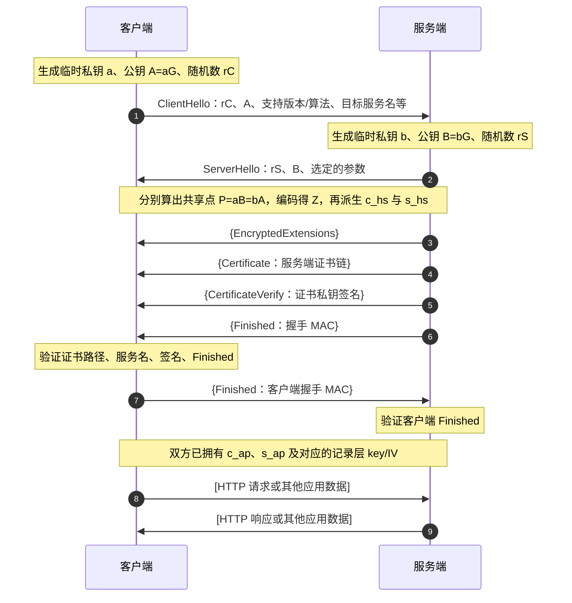
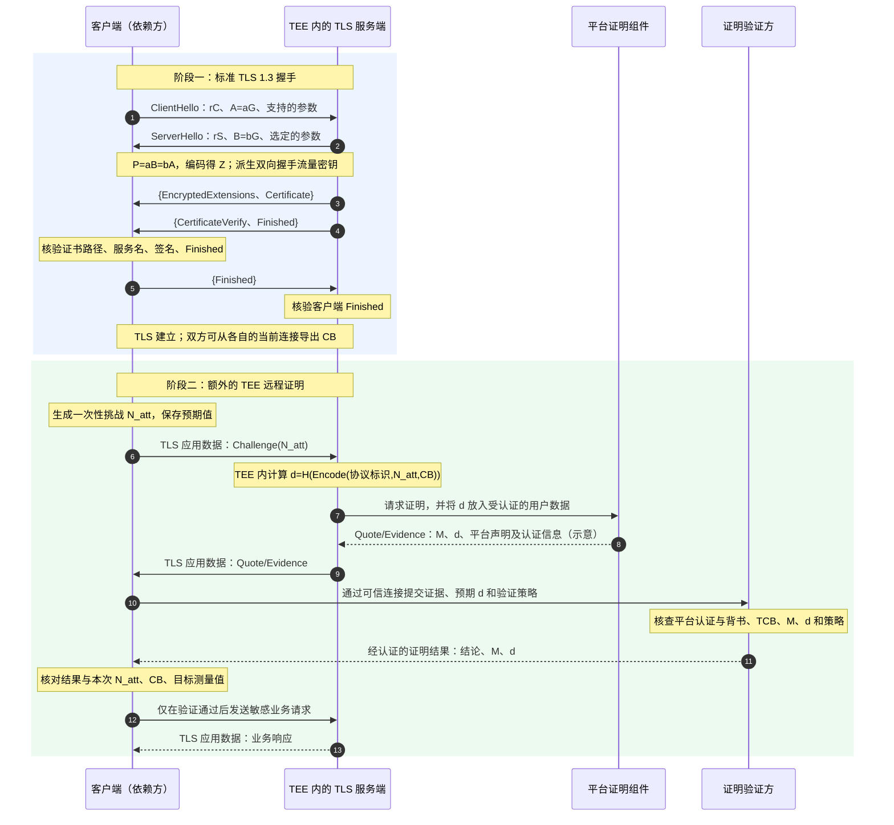

# TLS 1.3 会话建立：密钥协商、证书验证与可选的 TEE 远程证明

本文整理一次从连接发起到可以安全发送应用数据的过程，重点回答三个问题：**通信密钥怎样产生？客户端怎样确认服务端身份？`nonce`、`challenge` 和 `quote` 分别出现在哪里？**

> **阅读范围**：主体采用 TLS 1.3 的首次完整握手：服务端使用 X.509 证书认证，双方通过临时（EC）DHE 密钥交换，不使用 PSK、0-RTT、HelloRetryRequest 或客户端证书。后半部分另以“TLS 建立后进行 TEE 远程证明”为**应用协议示例**；它不是标准 TLS 握手的一部分。本文中的 `Quote` 是部分 TEE 平台对证明证据的称呼，跨平台术语是 *Evidence*。

## 目录

1. [先建立整体模型](#1-先建立整体模型)
2. [一次普通 TLS 1.3 会话的时序](#2-一次普通-tls-13-会话的时序)
3. [会话密钥的详细协商过程](#3-会话密钥的详细协商过程)
4. [TLS 证书验证的详细过程](#4-tls-证书验证的详细过程)
5. [三种容易混淆的 nonce](#5-三种容易混淆的-nonce)
6. [加入 TEE 证明后的一次完整会话](#6-加入-tee-证明后的一次完整会话)
7. [具体例子与常见误解](#7-具体例子与常见误解)
8. [参考规范与后续学习](#8-参考规范与后续学习)

## 1. 先建立整体模型

TLS 把两个任务结合起来：**握手层**协商参数、建立共享密钥并认证通信方；**记录层**使用协商出的密钥保护每一条后续消息。对常见 HTTPS 连接而言，客户端通常认证服务端，服务端未必认证客户端的证书。

下文出现的“会话密钥”不是单独的一把钥匙，而是一组有明确方向和用途的秘密：客户端与服务端各有握手流量秘密、应用流量秘密，最终各自导出写入密钥和 IV。这样设计使不同方向、不同阶段的加密材料彼此分开。[RFC 9846 §2](https://datatracker.ietf.org/doc/html/rfc9846#section-2)、[§7.1–7.3](https://datatracker.ietf.org/doc/html/rfc9846#section-7)

请先区分以下三项能力：

| 能力 | 核心机制 | 回答的问题 |
| --- | --- | --- |
| TLS 密钥协商 | 临时（EC）DHE + HKDF | 双方如何得到相同的流量密钥，同时不在网络上传输该密钥？ |
| TLS 服务端认证 | 证书链、服务名匹配、`CertificateVerify`、`Finished` | 当前握手的对方是否掌握目标服务证书的私钥，握手是否完整？ |
| 可选 TEE 远程证明 | `Challenge` + `Quote/Evidence` + 验证策略 | 对方是否在符合预期测量值和平台策略的受信执行环境中运行？ |

**标准 TLS 1.3 到第二项就完成了**。它没有名为 `Challenge` 或 `Quote` 的标准握手消息。若看到这些词，应先检查所讨论的是哪个额外的远程证明协议。[RFC 9846 §2](https://datatracker.ietf.org/doc/html/rfc9846#section-2)、[RFC 9334 §3](https://datatracker.ietf.org/doc/html/rfc9334#section-3)

## 2. 一次普通 TLS 1.3 会话的时序

下图中，`{…}` 表示已经使用握手流量密钥加密的握手消息；`[…]` 表示使用应用流量密钥保护的记录。省略 TCP 建连、证书链补全和错误告警。为便于理解，图中等双方完成 `Finished` 才开始应用数据；协议允许服务端在自己的首轮消息后更早发送应用数据。[RFC 9846 §2](https://datatracker.ietf.org/doc/html/rfc9846#section-2)



时序中的关键时间点：

1. `ClientHello` 与 `ServerHello` 交换临时公钥后，双方已能计算同一个（EC）DHE 共享秘密，并导出**握手**流量密钥。
2. 服务端的证书、签名和 `Finished` 随后在加密的握手记录内发送。客户端完成验证，才可把这条连接视为目标服务的连接。
3. 应用流量密钥与握手流量密钥不同；客户端发往服务端和服务端发往客户端也使用不同的密钥材料。

## 3. 会话密钥的详细协商过程

### 3.1 临时（EC）DHE：得到相同的共享秘密

以椭圆曲线群的写法说明：客户端随机选择临时私钥 `a`，发送 `A = aG`；服务端随机选择临时私钥 `b`，发送 `B = bG`。两侧分别计算：

```text
客户端：P = aB = a(bG)
服务端：P = bA = b(aG)
因此：  P = abG
送入 HKDF 的共享秘密：Z = EncodeSharedCoordinate(P)
```

上式是 ECDHE 的概念化写法：`P` 是椭圆曲线点；实际送入 HKDF 的 `Z` 是按所选群规则编码的共享坐标字节串，例如 X25519 的共享 `u` 坐标。`A`、`B` 可以被网络上的观察者看到；`a`、`b` 不发送，`Z` 也不发送。`ClientHello.random` 和 `ServerHello.random` **不是会话密钥**，也不能代替（EC）DHE 的共享秘密；它们是握手消息的一部分，进入握手摘要，从而参与后续密钥派生的上下文。[RFC 9846 §4.2](https://datatracker.ietf.org/doc/html/rfc9846#section-4.2)、[§7.4.2](https://datatracker.ietf.org/doc/html/rfc9846#section-7.4.2)

使用临时密钥并在不再需要时清除，有助于实现前向保密：未来即使服务端证书私钥泄露，攻击者仅凭以前抓到的握手流量和该私钥，也无法据此重建过去的 `Z`。这不涵盖过去的临时私钥或流量密钥本身已经泄露的情况。

### 3.2 HKDF：从一个共享秘密派生多组专用秘密

TLS 1.3 将（EC）DHE 结果送入一条分层的 HKDF 密钥日程。以下保留规范中的关键公式；`Derive-Secret(S, label, messages)` 会把对应握手消息的摘要作为上下文。`0` 表示规范要求的全零输入；即使没有 PSK，`Early Secret` 这一步仍然存在。[RFC 9846 §7.1](https://datatracker.ietf.org/doc/html/rfc9846#section-7.1)

```text
Early Secret     = HKDF-Extract(0, 0)                    # 此例无 PSK
Handshake Secret = HKDF-Extract(
                     Derive-Secret(Early Secret, "derived", ""), Z)

c_hs = Derive-Secret(Handshake Secret, "c hs traffic", ClientHello…ServerHello)
s_hs = Derive-Secret(Handshake Secret, "s hs traffic", ClientHello…ServerHello)

Main Secret = HKDF-Extract(
                Derive-Secret(Handshake Secret, "derived", ""), 0)

c_ap = Derive-Secret(Main Secret, "c ap traffic", ClientHello…server Finished)
s_ap = Derive-Secret(Main Secret, "s ap traffic", ClientHello…server Finished)
```

这里的 `c_hs` / `s_hs` 分别指客户端、服务端的握手流量秘密；`c_ap` / `s_ap` 是第一代应用流量秘密。应用流量秘密的派生使用截至**服务端 Finished** 的握手摘要，不必等客户端 Finished；上图等双方 Finished 完成后才发送应用数据，是便于学习的一条时序。当前 TLS 1.3 规范 RFC 9846 使用 **Main Secret** 这一名称，较旧材料中常见 **Master Secret**；阅读资料时注意术语对应。[RFC 9846 §7.1](https://datatracker.ietf.org/doc/html/rfc9846#section-7.1)

每个方向再从自己的流量秘密派生实际使用的 `write_key` 和 `write_iv`：

```text
write_key = HKDF-Expand-Label(traffic_secret, "key", "", key_length)
write_iv  = HKDF-Expand-Label(traffic_secret, "iv",  "", iv_length)
```

例如，客户端发出的记录使用客户端方向的 `write_key/write_iv`；服务端发出的记录使用服务端方向的材料。应用流量秘密还可通过 `KeyUpdate` 演进，但这不改变本次首次握手的主线。[RFC 9846 §7.2–7.3](https://datatracker.ietf.org/doc/html/rfc9846#section-7.2)

### 3.3 为什么还需要认证

单独运行（EC）DHE，只能让“正在互相交换公钥的两端”得出相同的 `Z`。主动攻击者可以分别与客户端和服务端做两次交换，形成中间人。TLS 通过证书、`CertificateVerify` 和 `Finished` 把本次密钥交换的握手记录与经过验证的服务身份联系起来；因此不能只看双方算出了同一把密钥。[RFC 9846 §4.5](https://datatracker.ietf.org/doc/html/rfc9846#section-4.5)

## 4. TLS 证书验证的详细过程

假设客户端准备访问 `https://api.example.com`，服务端发送自己的叶子证书和可用于构建路径的中间证书。客户端的工作分成三个相互关联的检查：

### 4.1 检查证书路径与服务身份

1. **建立到可信锚的证书路径**：用本地配置的信任锚（例如受信任的 CA 公钥）验证证书签名链，同时处理有效期、CA 约束、用途、名称约束、关键扩展等适用规则。吊销信息如何检查，取决于适用的证书体系和客户端策略；不能把“验证路径”简单理解成“在线查一次 OCSP”。[RFC 5280 §6](https://datatracker.ietf.org/doc/html/rfc5280#section-6)
2. **检查访问目标名称**：从客户端原本要访问的服务名得到期望身份，再与叶子证书的 `subjectAltName`（SAN）匹配。访问 `api.example.com` 时，受信任 CA 签发的 `other.example.com` 证书仍然不合格；以 IP 地址访问时，应与 SAN 中的 `iPAddress` 项精确匹配。现代服务身份规则不使用证书 `commonName` 作为 DNS 名称的回退匹配。[RFC 9525 §6](https://datatracker.ietf.org/doc/html/rfc9525#section-6)
3. **应用本地策略**：即使链和名称都满足通用规则，应用仍可能要求特定信任锚、证书用途或其他限制。验证结论始终依赖客户端采用的策略。

证书路径验证与服务名匹配合起来，说明“某个受信任体系把公钥绑定到这个服务身份”；它们还没有证明**当前握手对端**确实持有对应私钥。

### 4.2 `CertificateVerify`：证明持有证书私钥

服务端用叶子证书对应的私钥，对本次握手截至 `Certificate` 的摘要进行带上下文的签名。客户端使用证书中的公钥验证。摘要覆盖本次 `ClientHello`、`ServerHello`、协商参数、临时公钥等握手内容；替换本次（EC）DHE 公钥会破坏验证。这里可以把本次握手记录理解成一种**隐式挑战**，但标准 TLS 并没有单独的 `Challenge` 消息。[RFC 9846 §4.5.2](https://datatracker.ietf.org/doc/html/rfc9846#section-4.5.2)

### 4.3 `Finished`：确认密钥和握手完整性

服务端再用从服务端握手流量秘密派生出的 `finished_key`，对截至 `CertificateVerify` 的握手摘要计算 HMAC；客户端验证后，对包含**服务端 Finished** 的握手摘要计算自己的 `Finished`，服务端也验证。`CertificateVerify` 用的是**证书私钥的签名**；`Finished` 用的是**握手秘密派生的 MAC**。两者作用不同，缺一项都不能照此例认定握手成功。[RFC 9846 §4.5.3](https://datatracker.ietf.org/doc/html/rfc9846#section-4.5.3)

**证书私钥并不直接加密 HTTP 内容，也不被发送给客户端。**应用数据由（EC）DHE/HKDF 派生出的对称流量密钥保护。服务端证书证明的是所连接服务的身份；它本身不证明服务端程序运行于特定 TEE，或程序代码符合预期。

## 5. 三种容易混淆的 nonce

`nonce` 只表示“在其使用范围内不能按攻击者希望的方式重复”的值，具体目的要看所在协议。这里至少有三种不同的值：

| 名称 | 由谁产生，何时出现 | 是否出现在标准 TLS 中 | 作用 |
| --- | --- | --- | --- |
| `ClientHello.random`、`ServerHello.random` | 客户端、服务端分别在 Hello 消息中产生 | 是 | 公开的握手随机数，作为握手记录的一部分影响后续认证与密钥派生；不是对称流量密钥。 |
| 证明挑战 `N_att` | 此文示例中由客户端在 TLS 建立后产生 | 否 | 一次性、不可预测的挑战，用于检查证明证据是否回应了本次请求。其他证明协议也可让独立验证方产生它。 |
| TLS 记录层 `record_nonce` | 加密每条记录时，由当前写入 IV 与该方向的记录序号组合 | 是 | 保证同一流量密钥下的 AEAD 记录使用不同 nonce；它不是证明挑战。 |

TLS 1.3 每个读取和写入方向分别维护记录序号；换密钥时序号重置。单条记录的 nonce 计算方式为：

```text
record_nonce = write_iv XOR left_pad_zeros(record_sequence_number, iv_length)
```

所以“TLS 中有 nonce”可能指 Hello 随机数，也可能指逐记录 AEAD nonce；讨论远程证明时则常指挑战随机数。必须先指出具体字段。[RFC 9846 §4.2.2–4.2.3](https://datatracker.ietf.org/doc/html/rfc9846#section-4.2)、[§5.3](https://datatracker.ietf.org/doc/html/rfc9846#section-5.3)

## 6. 加入 TEE 证明后的一次完整会话

下面是**一种应用层组合方式**：先完成普通 TLS 握手，再在此 TLS 连接中请求 TEE 证明；客户端在验证通过前不发送敏感业务数据。不同平台的 Evidence 格式、证明角色和消息载体可以不同，并不存在由 TLS 1.3 统一规定的 `Quote` 消息。[RFC 9334 §3、§8](https://datatracker.ietf.org/doc/html/rfc9334#section-8)

图中假设服务端的 TLS 密码学端点及后续敏感数据处理都在**被测量的 TEE 内**。`P` 是平台提供的证明生成组件；`V` 是可信的独立证明验证方，也可以在某些系统中由客户端本地承担。`M` 表示测量值，`d` 表示要放进平台认证范围的绑定摘要。图中的 Quote 字段是示意，不代表所有 TEE 平台都有同名字段。



### 6.1 `Challenge`、`Quote` 分别做什么

- **挑战新鲜度**：客户端生成随机 `N_att`，只接受与该值绑定的证据。旧 Quote 中没有本次 `N_att`，不能直接重放。这个检查表明被认证的证据在挑战出现后形成；它本身并不证明所有被声明的状态都刚刚测量，也不保证状态此后永远不变。[RFC 9334 §10.2](https://datatracker.ietf.org/doc/html/rfc9334#section-10.2)
- **状态和平台认证**：Quote/Evidence 由受信任的证明机制认证，承载受测环境的声明。验证方依据平台背书、参考测量值、TCB 状态和本地策略评估，而不是只看其中有无 `N_att`。具体证据格式、证书或背书材料如何提供，取决于平台和证明协议。[RFC 9334 §3、§8](https://datatracker.ietf.org/doc/html/rfc9334#section-8)
- **会话绑定**：`CB = TLS-Exporter(应用专用标签, 协议规定的 context, 长度)` 从当前 TLS 连接导出。客户端与 TEE 内的服务端应独立得到相同的 `CB`，再把它和挑战按明确、无歧义的编码一起放入证据认证范围。这样，其他 TLS 连接上的证据无法直接用于本连接。此处使用普通 exporter，不使用可重放的 0-RTT early exporter；`CB` 是绑定值，**不是秘密加密密钥**。[RFC 9846 §7.5](https://datatracker.ietf.org/doc/html/rfc9846#section-7.5)、[RFC 9266 §2、§4](https://www.rfc-editor.org/rfc/rfc9266#section-4)

这里的 `d = H(Encode(协议标识, N_att, CB))` 是**教学用协议设计示意**，不是某个平台规定的字节格式。实际方案必须规定编码、哈希、长度、exporter 标签与 context、证据字段和验证规则，否则双方可能对“绑定了什么”有不同理解。

### 6.2 会话绑定的关键前提

**只把公开的 `N_att` 和 `CB` 写入 Quote，还不能证明 TLS 流量密钥就在 TEE 中。**反例：不可信宿主机自己终止 TLS，得到本连接的 `CB`，再把 `N_att` 与 `CB` 交给一个真实 TEE 生成 Quote。客户端可能收到完全真实、内容也匹配的 Quote，却把后续秘密发送给宿主机。

因此，图中的安全含义依赖于：被测量的 TEE 代码确实持有并使用当前 TLS 密码学连接的密钥，**从自己的连接状态**取得 exporter，并在 TEE 内处理后续敏感数据。另一种可行架构是使用外层 TLS 传输，但将敏感数据另行加密给“公钥经证明绑定到 TEE、私钥只在 TEE 内”的密钥对。这是 TLS 与 TEE 组合时必须单独论证的性质，不是 TLS 证书自动提供的保证。

## 7. 具体例子与常见误解

### 7.1 普通 HTTPS：只需要 TLS 阶段

客户端访问 `https://api.example.com`，检查服务端证书链最终归于自己信任的锚，叶子证书的 SAN 包含 `api.example.com`，并确认服务端对**这次握手**给出了有效的 `CertificateVerify` 和 `Finished`。之后双方用应用流量密钥交换 HTTP 数据。即使服务端证书真实有效，也只能说明身份和握手成立，不能据此推断进程运行在 TEE 内。

### 7.2 需要 TEE：挑战和绑定阻止旧证据跨会话复用

假设第一次连接产生 `CB₁`，客户端挑战为 `N₁`，证据中认证的值是 `d₁ = H(Encode(协议标识, N₁, CB₁))`。第二次连接若产生 `CB₂` 和 `N₂`，客户端期待的是 `d₂ = H(Encode(协议标识, N₂, CB₂))`。攻击者直接转发第一次的证据，`d₁` 与本次预期不符，验证失败。这个例子成立的前提仍是 TEE 内真实处理 TLS，或另有经证明的端到端密钥绑定。

### 7.3 一页纠错表

| 常见说法 | 更准确的理解 |
| --- | --- |
| “证书私钥加密会话密钥。” | 此例的共享秘密来自临时（EC）DHE；证书私钥用于本次握手的签名认证。 |
| “链到可信 CA，就一定是我要访问的网站。” | 还必须按访问目标核对叶子证书的服务身份。 |
| “`CertificateVerify` 就是 Quote。” | 前者证明证书私钥参与了 TLS 握手；后者是额外的运行环境证据。 |
| “TLS 的 random 就是远程证明 challenge。” | 两者可能都具有随机性，但在本例中属于不同协议阶段，验证规则也不同。 |
| “Quote 带着 TLS exporter，就证明密钥在 TEE。” | 只有受测代码从自己参与的 TLS 连接取出绑定值，并受证明机制约束，才能支持这一结论。 |

## 8. 参考规范与后续学习

- [RFC 9846：TLS 1.3](https://datatracker.ietf.org/doc/html/rfc9846)：握手消息、记录层 nonce、密钥日程、exporter。该规范于 2026 年 7 月取代早期的 RFC 8446。
- [RFC 5280：X.509 证书路径验证](https://datatracker.ietf.org/doc/html/rfc5280#section-6)：信任锚、路径和证书约束。
- [RFC 9525：TLS 服务身份验证](https://datatracker.ietf.org/doc/html/rfc9525#section-6)：DNS/IP 等目标服务身份与 SAN 的匹配。
- [RFC 9334：RATS 远程证明架构](https://datatracker.ietf.org/doc/html/rfc9334)：Attester、Verifier、Relying Party、Evidence、Endorsements 与新鲜度。
- [RFC 9266：TLS 1.3 通道绑定](https://www.rfc-editor.org/rfc/rfc9266#section-2)：标准 `tls-exporter` 绑定形式及其限制。本文的“应用专用 exporter”仅借用同类连接绑定思路，不声称其参数就是 RFC 9266 定义的固定 `tls-exporter` 值。

掌握本文主线后，可再分别学习 HelloRetryRequest、PSK/会话恢复、0-RTT 的重放风险、双向 TLS、证书吊销、KeyUpdate，以及具体 TEE 平台的 Evidence 格式。它们会改变部分消息或验证规则，但不应混进上面这条首次完整握手的基础时序。
